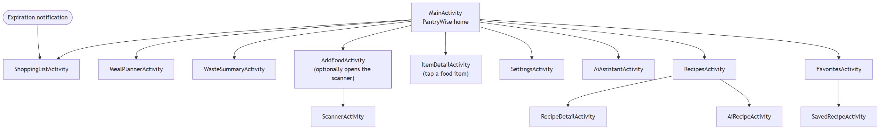

# 2. Features and status

This document lists what the app does today. Each feature has a status:

- **Implemented**: visible in the code and covered by an automated test, or by a manual check when the feature depends
  on the camera, the notification system or the user interface.
- **Partial**: works, but some expected behaviour is missing.
- **Planned**: not started.

The numbers in this document were taken from the code of the branch `feature/integration-followup`.

## 2.1 Screens and navigation

The main screen is the hub. Every other screen is reachable from it in one or two taps, and the back arrow always
returns to the previous screen.

| Screen | Purpose |
|---|---|
| `MainActivity` | Inventory by storage place with search, quick access buttons, help and settings |
| `AddFoodActivity` | Form to add a food item, with a barcode scan button |
| `ScannerActivity` | Camera preview that reads a barcode, or a manual entry dialog |
| `ItemDetailActivity` | Edit an item, record what happened to it, or delete it |
| `WasteSummaryActivity` | Consumed, wasted, expired and donated counts and the waste rate |
| `ShoppingListActivity` | The shopping list. Destination of the expiration notification |
| `MealPlannerActivity` | Weekly planner with seven day cards and four meal slots each |
| `SettingsActivity` | Theme and text size |
| `AiAssistantActivity` | Chat with the AI kitchen assistant |
| `RecipesActivity` | Recommendations, search and Zero-Waste Mode |
| `RecipeDetailActivity` | Recipe ingredients, nutrition, substitutes, plan and favourite actions |
| `AiRecipeActivity` | An AI-written recipe built from expiring food |
| `FavoritesActivity` | Saved recipes (Edamam and AI) |
| `SavedRecipeActivity` | A saved AI recipe, readable offline |

In debug builds there is also `DevToolsActivity`, reached with the small **DEV** button next to settings. It seeds
sample data and runs the expiration check on demand. It is not part of release builds.

## 2.2 Feature matrix

### Inventory and main interface

| Feature | Main classes | Status | Evidence |
|---|---|---|---|
| Inventory by Fridge, Freezer and Pantry | `MainActivity`, `InventoryViewModel`, `FoodAdapter` | Implemented | `FoodItemDaoTest`; manual |
| Search food by name | `MainActivity` | Implemented | manual |
| Colour-coded freshness (Fresh, Use Soon, Expired, No date) | `FoodAdapter`, `ExpiryUtils`, `Freshness` | Implemented | `ExpiryUtilsTest` |
| Add food (name, quantity, unit, place, expiration date) | `AddFoodActivity` | Implemented | manual |
| Edit food, delete it, record consumed / wasted / expired / donated | `ItemDetailActivity`, `ItemDetailViewModel` | Implemented | `PantryRepositoryTest`; manual |
| Pass a food item between screens | `FoodItem` (`Parcelable`) | Implemented | `FoodItemParcelTest` |
| Theme (system, light, dark) and text size | `SettingsActivity`, `DisplayPreferences` | Implemented | manual |
| In-app help guide | `MainActivity` (dialog) | Implemented | manual |
| English and Spanish | `res/values`, `res/values-es` | Implemented | every string exists in both languages (checked with a script and lint) |
| State kept on rotation | `MainActivity`, `MealPlannerActivity`, `ShoppingListActivity` | Implemented | manual |

### Data layer and waste statistics

| Feature | Main classes | Status | Evidence |
|---|---|---|---|
| Room database, 10 entities, DAOs | `PantryDatabase`, `data/entity`, `data/dao` | Implemented | `FoodItemDaoTest`, `PantryRepositoryTest` |
| Single data access point | `PantryRepository` | Implemented | `PantryRepositoryTest` and related repository tests |
| Migrations from version 1 to 4 | `Migrations` | Implemented | `MigrationsTest`, `Migration3To4Test` |
| Consumption history | `ConsumptionHistory`, `ConsumptionHistoryDao` | Implemented | `PantryRepositoryTest` |
| Waste summary (7 days, 30 days, all time) | `WasteSummaryActivity`, `WasteStatsCalculator` | Implemented | `WasteStatsCalculatorTest` |
| Ingredient name normalization | `IngredientNormalizer` | Implemented | `IngredientNormalizerTest` |

### Barcode scanner

| Feature | Main classes | Status | Evidence |
|---|---|---|---|
| Read UPC and EAN barcodes with the camera | `ScannerActivity` (CameraX, ML Kit) | Implemented | manual (needs a camera) |
| Product lookup in USDA FoodData Central, through the backend | `BarcodeViewModel`, `AiApiService`, backend `productService` | Implemented | `BarcodeViewModelTest`, backend `product.test.js`, manual |
| Manual barcode entry as fallback | `ScannerActivity` | Implemented | manual |
| Camera permission with an explanation dialog | `ScannerActivity` | Implemented | manual |
| Autofill the food name in the add-food form | `AddFoodActivity`, `ScannerActivity` | Implemented | manual |
| Retry action on a network failure | `ScannerActivity` | Partial | an error toast is shown, but there is no Snackbar with a retry button |
| Saved frequent items for faster entry | - | Planned | not started |
| Automated UI test of the scan flow | - | Planned | there are no Espresso tests yet |

### Expiration reminders, shopping list and meal planner

| Feature | Main classes | Status | Evidence |
|---|---|---|---|
| Daily check around 09:00 for expired items and items expiring within 3 days | `PantryWiseApp`, `ExpirationScheduler`, `ExpirationWorker`, `ExpirationChecker`, `ExpirationTiming` | Implemented | `ExpirationSchedulerTest`, `ExpirationCheckerTest`, `ExpirationTimingTest` |
| Notification that opens the shopping list | `NotificationHelper` | Implemented | manual |
| Notification permission handling (explanation, settings fallback) | `NotificationPermissionHelper` | Implemented | manual |
| Shopping list: add, edit, tick, delete with undo, clear completed, share | `ShoppingListActivity`, `ShoppingListViewModel` | Implemented | `ShoppingInputValidatorTest`, `ShoppingListFormatterTest`, `ShoppingRepositoryTest` |
| List grouped by suggested shop, with a maps button | `StoreAdvisor`, `StoreGrouper`, `StorePreferences` | Implemented | `StoreAdvisorTest`, `StoreGrouperTest`, `StorePreferencesTest` |
| Weekly meal planner (7 days x 4 meals, week navigation) | `MealPlannerActivity`, `MealPlanGrouper`, `WeekUtils` | Implemented | `MealPlanGrouperTest`, `WeekUtilsTest` |
| Compare the plan with the inventory and add only what is missing | `ShoppingListGenerator`, `ShoppingCalculator`, `IngredientParser`, `UnitUtils` | Implemented | `ShoppingCalculatorTest`, `ShoppingListGeneratorTest`, `ShoppingGenerationRepositoryTest` |

### AI kitchen assistant and recipes

| Feature | Main classes | Status | Evidence |
|---|---|---|---|
| Chat that knows the inventory, remembers the conversation, asks for consent first | `AiAssistantActivity`, `AiChatViewModel` | Implemented | `AiChatViewModelTest` (history and new chat); the consent dialog is checked by hand |
| AI recipe from expiring food | `AiRecipeActivity`, `AiRecipeViewModel` | Implemented | `AiRecipeJsonTest`, `AiRecipeFavoriteTest` |
| Recipe recommendations ranked by pantry match | `RecipesActivity`, `RecipeViewModel`, `RecipeRepository` | Implemented | `RecipeViewModelTest`, `IngredientMatcherTest` |
| Recipe search by keyword | `RecipesActivity`, `RecipeRepository` | Implemented | `RecipeViewModelTest` |
| Zero-Waste Mode (only recipes that use expiring food) | `RecipeViewModel` | Implemented | `RecipeViewModelTest` |
| Recipe details, nutrition, link to the original recipe | `RecipeDetailActivity`, `RecipeDetailViewModel` | Implemented | `RecipeDetailViewModelTest`, `RecipeDetailJsonTest` |
| Ingredient substitutes (local table first, AI second) | `RecipeDetailViewModel`, backend `substituteService` | Implemented | backend `substitute.test.js`, instrumented `RecipeSubstituteTest` |
| Favourites (Edamam and AI recipes), AI recipes readable offline | `FavoritesActivity`, `SavedRecipeActivity`, `FavoriteRecipeMapper` | Implemented | `FavoriteRecipeRepositoryTest`, `FavoritesViewModelTest`, `FavoriteRecipeMapperTest` |
| Plan a recipe in the meal planner | `MealPlanPicker` | Implemented | `PlanMealTest`, `PlanDatesTest` |
| Add the missing ingredients of a recipe to the shopping list | `MissingIngredients` | Implemented | `MissingIngredientsTest`, `ShoppingAddMissingTest` |
| Clear errors with retry, and no crash on a bad reply | `AiErrorText`, `RecipeErrorText`, `ApiCalls` | Implemented | `ApiCallsTest`, `AiRecipeErrorTextTest` |
| Answers in Spanish when the app is in Spanish | `AiRepository` (sends the language tag) | Implemented | `ChatRequestJsonTest` |
| Dietary preferences and allergies | backend accepts them | Partial | the app does not have a preferences screen yet and sends no preferences |
| Recipe filters (diet, cuisine, calories) | backend accepts them | Partial | there is no filter panel in the app |
| Chat answers that use Edamam nutrition values | - | Partial | nutrition is shown on the recipe screen, but the chat does not receive it |

### Backend

| Feature | Main files | Status | Evidence |
|---|---|---|---|
| Express server with seven endpoints | `backend/src/app.js`, `routes/`, `controllers/` | Implemented | `validate.test.js`, `claude-chat-prompts.test.js`, `recommend.test.js`, `product.test.js`, Postman collection |
| Claude and Edamam called only from the server, keys in `.env` | `claudeService.js`, `edamamService.js`, `config/env.js` | Implemented | `claude-chat-prompts.test.js`, `edamam.test.js` |
| Request validation and a single JSON error format | `middleware/validate.js`, `errorHandler.js` | Implemented | `validate.test.js` |
| Rate limits (general, AI, recipes) | `middleware/rateLimiter.js` | Implemented | see the limits in [AI engine](engineering/04-ai-engine.md) |
| Recipe ranking by pantry match and expiry | `recommendationService.js` | Implemented | `recommend.test.js` |

## 2.3 Cross-cutting capabilities

| Capability | State |
|---|---|
| English and Spanish | Complete. Every visible text comes from a resource file in both languages. Only symbols such as the back arrow are written directly in layouts |
| Dark mode | Main screen, add-food form and detail screen use colour resources with a night variant. Other screens use the Material 3 theme |
| System bars | Every screen applies window insets, because the target SDK is 37 and the app draws edge to edge |
| Rotation | Edit boxes with an id restore their text. The main screen, the planner and the shopping list also save their own state |
| Permissions | Camera and notifications are requested at runtime after an explanation. The app keeps working if either is denied |
| Back navigation | Every screen has a visible way back: a toolbar arrow or a back button. The notification opens the shopping list on top of the main screen |
| Logging | `Log.d/i/w/e` with a `TAG` in the classes that log. No user data is logged |

## 2.4 Known limitations

- There is no preferences screen, so dietary preferences and allergies are not sent to the assistant and recipes cannot
  be filtered by diet, cuisine or calories. See the [roadmap](04-roadmap.md).
- The barcode lookup needs the backend to be running with a `USDA_API_KEY` in `backend/.env` (`DEMO_KEY` works but is rate limited).
- The AI, recipe and barcode features need the backend to be running. In release builds the backend address is a placeholder
  (`example.invalid`), so those features only work in debug builds until the backend is hosted.
- The rate limits of the backend count requests per IP address, not per device.
- The notification time is fixed around 09:00 and the warning window is fixed to 3 days.
- There are no automated user interface tests (Espresso). The screens are checked by hand with a written script.
- Edamam changes its plans from time to time. Check that your Edamam account includes the Recipe Search API
  before relying on the recipe features.
