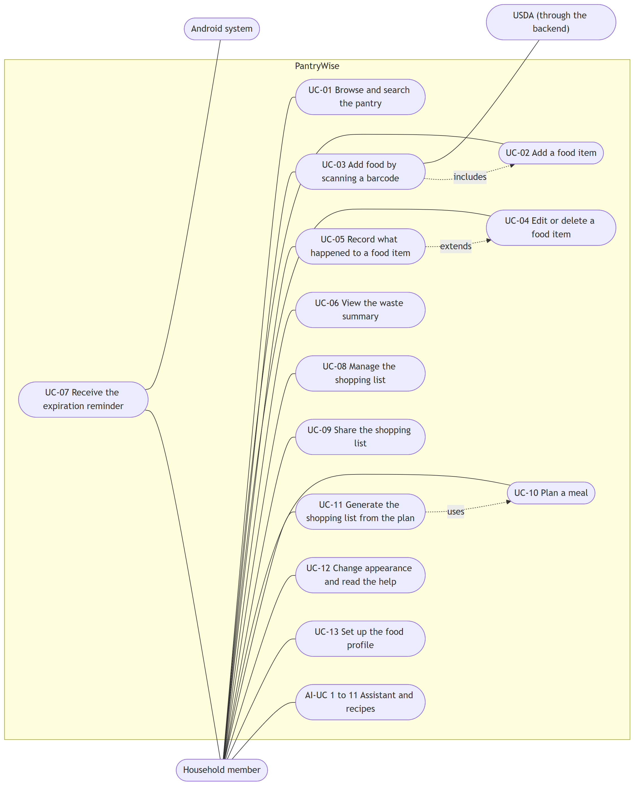
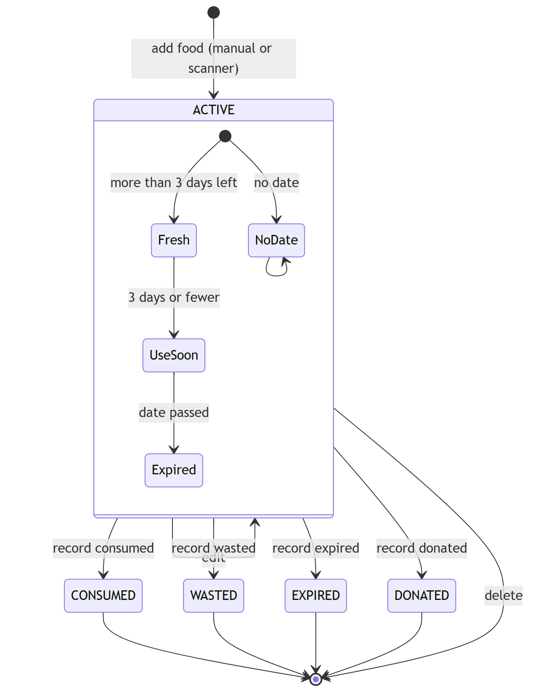
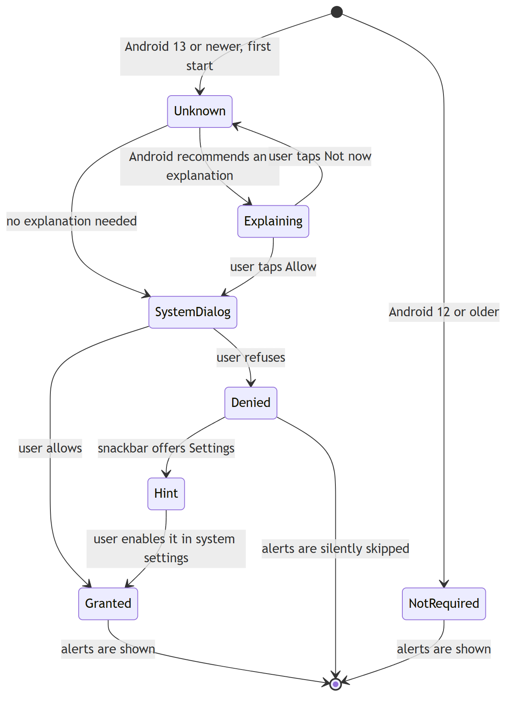
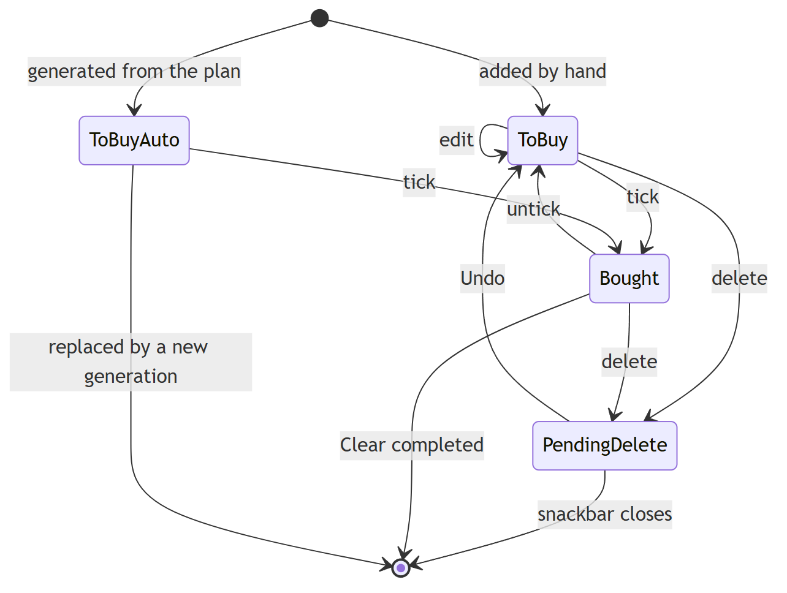
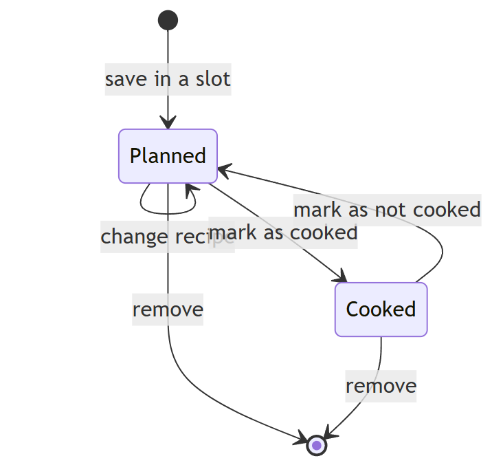
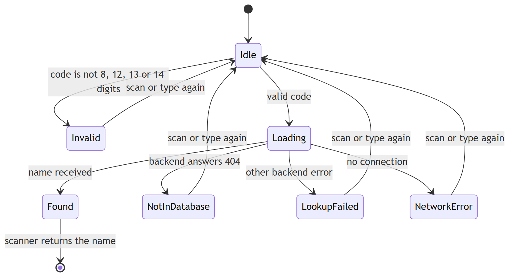
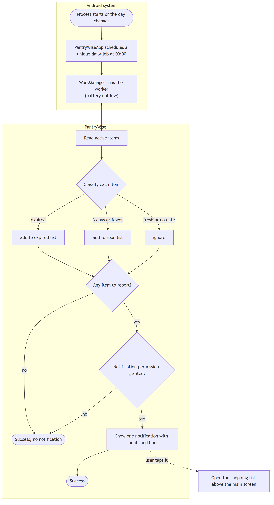
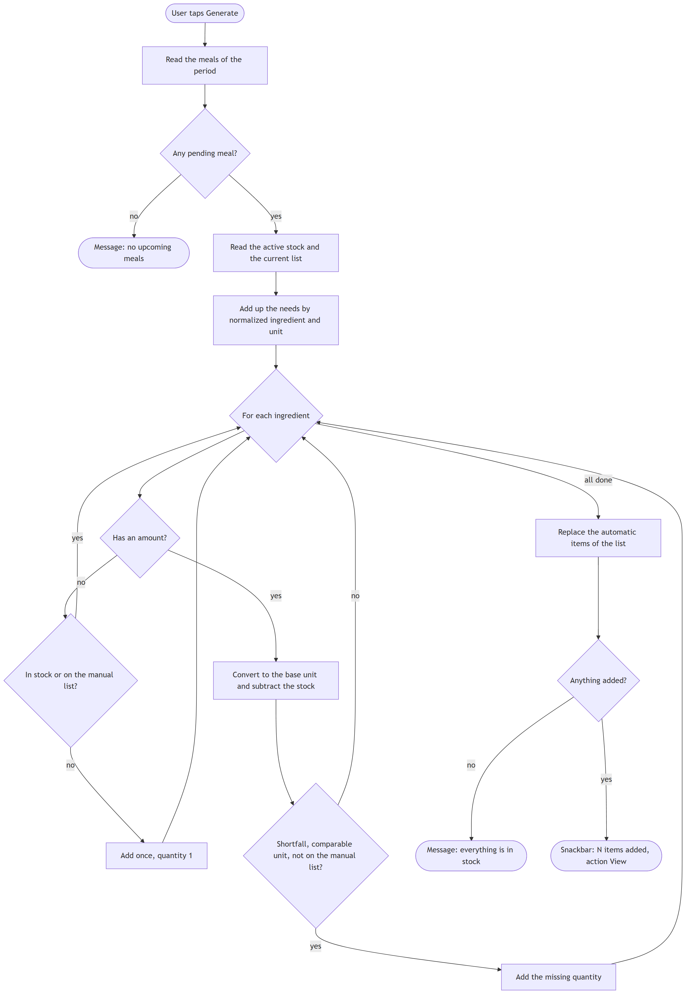
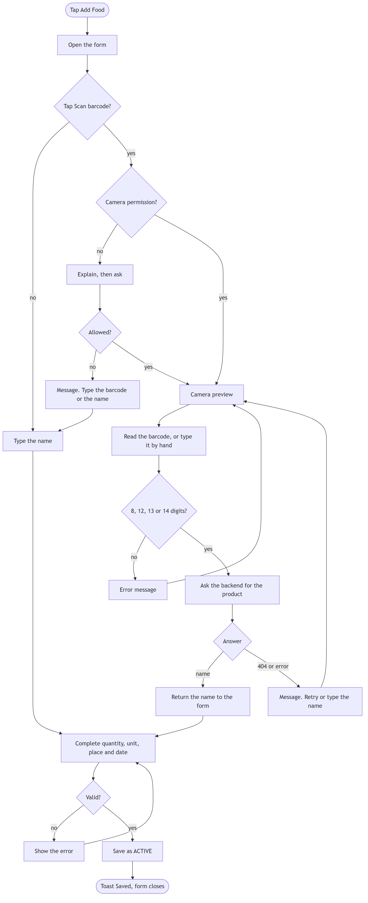

# Specification

This document says **what PantryWise must do**, from the point of view of the people who use it: who they are, the
use cases, the user stories with their acceptance criteria and tasks, how the main objects change state, how the main
processes flow, and the non-functional requirements. How it is built is in [Design](02-design.md) and
[Architecture](03-architecture.md).

The AI kitchen assistant and the recipe engine (10 use cases and 27 user stories written by the AI member) are
specified in [AI engine](04-ai-engine.md) so that they sit next to the workflow they describe. They use the prefixes
**AI-UC** and **AI-US**. The rest of the app is specified here with the prefixes **UC** and **S**.

Status words: **Implemented** (visible in the code and covered by a test or a manual check), **Partial** (some
acceptance criteria are missing) and **Planned** (not started). Evidence refers to test classes; "manual" means it is
checked with the written test script.

## 1. Scope and actors

PantryWise is a mobile app for one household. It keeps an inventory of food, warns before it expires, records what
was thrown away, plans meals and builds a shopping list with only what is missing. It also offers recipes and an AI
assistant (see [AI engine](04-ai-engine.md)).

| Actor | Type | Role |
|---|---|---|
| Household member | Primary | Uses every screen. There are no accounts: the data belongs to the device |
| Android system | Secondary | Starts the daily check in the background, shows the notification, provides the camera and the share sheet |
| Backend | Secondary | Answers barcode, recipe and AI requests, and keeps the API keys |
| USDA FoodData Central | External | Gives the product name of a barcode (through the backend) |

**In scope:** pantry inventory, barcode scanning, expiration reminders, waste statistics, shopping list, weekly meal
planner, food profile, settings, English and Spanish.

**Out of scope for this delivery:** accounts and cloud sync, several households, price tracking, tablet layouts, and
a hosted backend (see the [roadmap](../04-roadmap.md)).

### Use case diagram

## 2. Use cases

| ID | Use case | Actor | Status |
|---|---|---|---|
| UC-01 | Browse and search the pantry | Household member | Implemented |
| UC-02 | Add a food item | Household member | Implemented |
| UC-03 | Add food by scanning a barcode | Household member, USDA | Implemented |
| UC-04 | Edit or delete a food item | Household member | Implemented |
| UC-05 | Record what happened to a food item | Household member | Implemented |
| UC-06 | View the waste summary | Household member | Implemented |
| UC-07 | Receive the expiration reminder | Android system, household member | Implemented |
| UC-08 | Manage the shopping list | Household member | Implemented |
| UC-09 | Share the shopping list | Household member | Implemented |
| UC-10 | Plan a meal | Household member | Implemented |
| UC-11 | Generate the shopping list from the plan | Household member | Implemented |
| UC-12 | Change appearance and read the help | Household member | Implemented |
| UC-13 | Set up the food profile | Household member | Implemented |

### UC-01 Browse and search the pantry

| | |
|---|---|
| **Actor** | Household member |
| **Precondition** | The app is installed. The pantry may be empty |
| **Trigger** | The user opens the app |
| **Main flow** | 1. The main screen shows the food in the Fridge. 2. The user taps *Fridge*, *Freezer* or *Pantry* to change the place. 3. Each item shows its name, quantity and a colour badge: Fresh, Use soon, Expired or No date. 4. The user types in the search box and the list narrows to the names that match. 5. The user taps an item to open it (UC-04) |
| **Alternate flows** | A. The place has no food: an empty-state message is shown. B. The search has no result: a "no results" message is shown. C. The device is rotated: the search text and the selected place are kept |
| **Postcondition** | Nothing changes in the data |
| **Evidence** | `FoodItemDaoTest`, `ExpiryUtilsTest`; manual |

### UC-02 Add a food item

| | |
|---|---|
| **Actor** | Household member |
| **Precondition** | The user is on the main screen |
| **Trigger** | The user taps *Add Food* |
| **Main flow** | 1. The form opens. 2. The user types the name, quantity and unit, chooses the storage place and, optionally, an expiration date with a date picker. 3. The user taps *Save Food*. 4. The app stores the item as active, with a normalized name. 5. A message confirms it and the form closes. The item is now in the pantry list |
| **Alternate flows** | A. A required field is empty: the message "Please fill in all fields" is shown and nothing is saved. B. The quantity is not a number or is not greater than zero: a specific message is shown. C. No date is chosen: the item is saved with "no date" and is never reported as expiring |
| **Postcondition** | A new `FoodItem` with status `ACTIVE` exists |
| **Evidence** | `PantryRepositoryTest`; manual |

### UC-03 Add food by scanning a barcode

| | |
|---|---|
| **Actor** | Household member. Secondary: USDA through the backend |
| **Precondition** | The user is on the add-food form |
| **Trigger** | The user taps *Scan barcode* |
| **Main flow** | 1. If the camera permission is missing, the app explains why and asks for it. 2. The camera preview opens. 3. The user points it at a barcode. 4. The app reads the code, checks it has 8, 12, 13 or 14 digits, and asks the backend for the product. 5. The backend answers with the product name. 6. The scanner closes and the name is written in the form. 7. The user completes the form (UC-02) |
| **Alternate flows** | A. The camera permission is denied: a message is shown and the user can still type the barcode. B. *Enter Barcode Manually* opens a dialog for the digits. C. The code is invalid: an error message is shown and the scan can be repeated. D. The product is not in the database: the message says so and asks to type it by hand. E. The backend cannot be reached or has no USDA key: a network or "unable to retrieve" message is shown. F. *Back* closes the scanner without a result |
| **Postcondition** | The form has the product name. Nothing is stored until the user saves |
| **Evidence** | `BarcodeViewModelTest`, backend `product.test.js`; manual (needs a camera) |

### UC-04 Edit or delete a food item

| | |
|---|---|
| **Actor** | Household member |
| **Precondition** | An item exists |
| **Trigger** | The user taps an item in the pantry list |
| **Main flow** | 1. The detail screen shows the item. 2. The user changes name, quantity, unit, place or date and taps *Save Changes*. 3. The app updates the item (the name is normalized again) and confirms |
| **Alternate flows** | A. The user taps *Delete*: a confirmation dialog appears. After confirming, the item is removed. B. The item cannot be loaded: an error message is shown and the screen closes. C. Validation errors are shown as in UC-02 |
| **Postcondition** | The item is updated or deleted |
| **Evidence** | `PantryRepositoryTest`, `FoodItemParcelTest` (the item travels as a `Parcelable`); manual |

### UC-05 Record what happened to a food item

| | |
|---|---|
| **Actor** | Household member |
| **Precondition** | An active item is open in the detail screen |
| **Trigger** | The user taps *Consumed*, *Wasted*, *Expired* or *Donated* |
| **Main flow** | 1. The app writes a history row with the item's name, quantity, category and the chosen outcome, and changes the item's status, in one transaction. 2. The item disappears from the pantry, from the alerts and from the stock used for shopping. 3. A message confirms it and the screen closes |
| **Alternate flows** | A. The operation fails: an error message is shown and nothing changes, because the transaction is undone |
| **Postcondition** | A `ConsumptionHistory` row exists and the item is no longer active |
| **Evidence** | `PantryRepositoryTest`; manual |

### UC-06 View the waste summary

| | |
|---|---|
| **Actor** | Household member |
| **Precondition** | None. With no history the figures are zero |
| **Trigger** | The user taps *Waste Summary* on the main screen |
| **Main flow** | 1. The screen shows the counts of consumed, wasted, expired and donated items for the last 30 days. 2. The user switches the period to 7 days or all time. 3. The waste rate is recalculated |
| **Alternate flows** | A. The history is empty: all counts are zero and the rate is zero, with no division error |
| **Postcondition** | Nothing changes in the data |
| **Evidence** | `WasteStatsCalculatorTest`; manual |

### UC-07 Receive the expiration reminder

| | |
|---|---|
| **Actor** | Android system, household member |
| **Precondition** | The app has been opened at least once, so the daily check is scheduled |
| **Trigger** | About 09:00 every day (or *Run expiration check now* in the debug tools) |
| **Main flow** | 1. The system starts the check in the background. 2. The app reads the active items and keeps those that have expired or expire within 3 days. 3. If there are any, it shows one notification with the counts and up to a few lines. 4. The user taps it. 5. The shopping list opens on top of the main screen |
| **Alternate flows** | A. Nothing is expired or about to expire: no notification. B. The notification permission is denied: nothing is shown and the app does not crash. C. The check fails: it is retried up to three times. D. The user presses *Back* from the shopping list: the main screen opens, not the home screen of the phone |
| **Postcondition** | At most one notification per run |
| **Evidence** | `ExpirationCheckerTest`, `ExpirationSchedulerTest`, `ExpirationTimingTest`; manual |

### UC-08 Manage the shopping list

| | |
|---|---|
| **Actor** | Household member |
| **Precondition** | None |
| **Trigger** | The user taps *Shopping List* |
| **Main flow** | 1. The list shows each item with quantity, unit and optional store, and a counter "to buy / done". 2. The user types a name, optional quantity, unit and store and taps *Add*. 3. The user ticks an item when it is bought. 4. The user edits an item with a dialog. 5. The user deletes an item and may tap *Undo* in the snackbar. 6. The user taps *Clear completed* and confirms |
| **Alternate flows** | A. The name is empty or the quantity is not greater than zero: an error is shown in the field. B. The list is empty: an empty-state message is shown. C. The user groups the list by suggested shop and can rename the kinds of shop |
| **Postcondition** | The list reflects the changes and survives closing the app |
| **Evidence** | `ShoppingInputValidatorTest`, `ShoppingRepositoryTest`, `StoreGrouperTest`, `StorePreferencesTest`; manual |

### UC-09 Share the shopping list

| | |
|---|---|
| **Actor** | Household member |
| **Precondition** | The list has items |
| **Trigger** | The user taps *Share* in the menu |
| **Main flow** | 1. The app builds a plain-text list. 2. It opens the share sheet with an implicit `ACTION_SEND` intent. 3. The user picks an app |
| **Alternate flows** | A. The list is empty: "Nothing to share yet". B. No app can handle the intent: "No app available to share the list" |
| **Postcondition** | Nothing changes in the data |
| **Evidence** | `ShoppingListFormatterTest`; manual |

### UC-10 Plan a meal

| | |
|---|---|
| **Actor** | Household member |
| **Precondition** | None |
| **Trigger** | The user opens *Meal Planner* and taps an empty slot |
| **Main flow** | 1. The planner shows seven days, each with Breakfast, Lunch, Dinner and Snack. 2. The user taps a slot and chooses a favourite recipe, or *Custom recipe* with a title and ingredients (name, optional quantity, unit). 3. The user saves. 4. The slot shows the recipe. 5. The user can change it, mark it as cooked or remove it. 6. The user moves between weeks with the arrows or returns with *Today* |
| **Alternate flows** | A. A custom recipe has no title: an error is shown. B. An ingredient has no quantity: it counts as "only check that I have it". C. The week is rotated or the screen recreated: the displayed week is kept |
| **Postcondition** | A `MealPlan` with its ingredient rows exists |
| **Evidence** | `MealPlanGrouperTest`, `WeekUtilsTest`, `PlanMealTest`; manual |

### UC-11 Generate the shopping list from the plan

| | |
|---|---|
| **Actor** | Household member |
| **Precondition** | At least one pending (not cooked) meal exists from today onwards |
| **Trigger** | The user taps *Generate shopping list* in the planner, or *Generate from plan* in the shopping list |
| **Main flow** | 1. The app adds up the ingredients of the pending meals. 2. It compares them with the active stock by normalized name, converting units. 3. It replaces the automatic items of the list with the missing quantities, and keeps the items the user typed by hand (an ingredient already on the list as an unticked manual item is not added again). 4. A snackbar says how many items were added and offers *View* |
| **Alternate flows** | A. No pending meals: the message says there are no upcoming meals. B. Everything is in stock: the message says so. C. An ingredient has no quantity: it is added once if the pantry has none. D. The unit of the stock cannot be compared with the recipe (cups and grams): the ingredient is not added, to avoid false alarms |
| **Postcondition** | The automatic part of the list matches the plan. Generating twice gives the same list |
| **Evidence** | `ShoppingCalculatorTest`, `ShoppingListGeneratorTest`, `ShoppingGenerationRepositoryTest` |

### UC-12 Change appearance and read the help

| | |
|---|---|
| **Actor** | Household member |
| **Precondition** | None |
| **Trigger** | The user taps *Settings* or *Help* |
| **Main flow** | 1. In settings the user chooses System, Light or Dark theme and a text size, and taps *Save Settings*. 2. The app applies them and remembers them. 3. *Help* opens a guide dialog that explains each screen |
| **Alternate flows** | A. The language follows the phone: English or Spanish, with no setting inside the app |
| **Postcondition** | The preferences are kept in `SharedPreferences` |
| **Evidence** | manual |

### UC-13 Set up the food profile

| | |
|---|---|
| **Actor** | Household member |
| **Precondition** | None. The screen opens by itself the first time the app is launched |
| **Trigger** | First launch, or the user taps *Food profile* in Settings, in the Recipes toolbar or in the chat menu |
| **Main flow** | 1. The user types a name. 2. The user adds allergies as words, or ticks "I have no food allergies" (one of the two is required). 3. Optionally the user ticks "must be" labels (for example vegetarian, gluten-free), a diet and a fitness goal. 4. The user taps *Save*. 5. The profile is kept on the phone and the app asks for the notification permission |
| **Alternate flows** | A. The name is empty or has digits or symbols: the field shows an error and nothing is saved. B. Allergies are unanswered: the screen asks for an answer. C. An invalid allergy (digits, too long) is refused and the screen says why. D. From Settings or the toolbars the user edits an existing profile and the next request uses the new values |
| **Postcondition** | Every AI and recipe request carries the allergies, labels, diet and goal. Recipes with an allergen are flagged |
| **Evidence** | `FoodProfileViewModelTest`, `FoodProfileRulesTest`, `AiPreferencesTest`, `AiPreferencesStoreTest`, `CurrentPreferencesTest`; manual |

## 3. User stories and tasks

Each story has acceptance criteria and the technical tasks that implement it. Stories are grouped by area.

### 3.1 Inventory and main interface

| ID | Story | Acceptance criteria | Tasks | Status |
|---|---|---|---|---|
| S-01 | As a user, I want to see my food by Fridge, Freezer and Pantry, so that I know what I have and where | Three places; the list updates when data changes; the empty place has a message | `MainActivity`, `InventoryViewModel`, `FoodAdapter`, `FoodItemDao` | Implemented |
| S-02 | As a user, I want to search my food by name | The list narrows as I type; "no results" message; the text survives rotation | `MainActivity` (`TextWatcher`, `onSaveInstanceState`) | Implemented |
| S-03 | As a user, I want a colour for the freshness of each item | Fresh, Use soon (3 days or fewer), Expired, No date; computed from the date, not stored | `ExpiryUtils`, `Freshness`, `FoodAdapter` | Implemented |
| S-04 | As a user, I want to add a food item manually | Name, quantity, unit, place, optional date; invalid input is explained; saved on the background thread | `AddFoodActivity`, `PantryRepository.insertFoodItem`, `IngredientNormalizer` | Implemented |
| S-05 | As a user, I want to edit or delete an item | Edit with validation; delete asks to confirm; the object is passed between screens as `Parcelable` | `ItemDetailActivity`, `ItemDetailViewModel`, `FoodItem` | Implemented |
| S-06 | As a user, I want to say what happened to an item | Consumed, wasted, expired or donated; the item leaves the pantry and a history row is written, all or nothing | `PantryRepository.recordDisposition`, `ConsumptionHistory` | Implemented |
| S-07 | As a user, I want to choose light or dark mode and the text size | System, Light, Dark; text size; both kept after restart | `SettingsActivity`, `DisplayPreferences` | Implemented |
| S-08 | As a user, I want a help guide inside the app | One dialog that explains every screen | `MainActivity`, `strings_main.xml` | Implemented |
| S-09 | As a Spanish speaker, I want the whole app in Spanish | Every visible text exists in English and Spanish, with plurals and positional arguments | `res/values`, `res/values-es` | Implemented |

### 3.2 Barcode scanner

| ID | Story | Acceptance criteria | Tasks | Status |
|---|---|---|---|---|
| S-10 | As a user, I want to scan a barcode to fill the food name | The camera reads UPC and EAN codes; the name is written in the form; a failure never crashes | `ScannerActivity` (CameraX, ML Kit), `BarcodeViewModel`, backend `productService` | Implemented |
| S-11 | As a user, I want to be asked before the camera is used | An explanation dialog, then the system request; if denied, a message and a manual alternative | `ScannerActivity` | Implemented |
| S-12 | As a user, I want to type the barcode if I cannot scan it | A dialog accepts digits and validates 8, 12, 13 or 14 digits | `ScannerActivity`, `BarcodeViewModel` | Implemented |
| S-13 | As a user, I want to go back from the scanner at any moment | A back button closes it without a result | `ScannerActivity` | Implemented |
| S-14 | As a user, I want a **Retry** action when the lookup fails because of the network | A snackbar with a Retry button | `ScannerActivity` | **Partial** (an error message is shown, with no Retry button) |
| S-15 | As a user, I want my frequent items saved to add them quickly | A list of frequent items | - | Planned |

### 3.3 Waste statistics

| ID | Story | Acceptance criteria | Tasks | Status |
|---|---|---|---|---|
| S-16 | As a user, I want to see how much food I waste | Counts per outcome and the waste rate for 7 days, 30 days or all time; zero history gives zeros | `WasteSummaryActivity`, `WasteSummaryViewModel`, `WasteStatsCalculator`, `ConsumptionHistoryDao` | Implemented |

### 3.4 Expiration reminders

| ID | Story | Acceptance criteria | Tasks | Status |
|---|---|---|---|---|
| S-17 | As a user, I want a daily notification about food that expired or will expire soon | Around 09:00; includes expired items and items within 3 days; one notification per run; none if nothing qualifies; not repeated by restarting the app | `PantryWiseApp`, `ExpirationScheduler` (unique periodic work), `ExpirationWorker`, `ExpirationChecker`, `NotificationHelper` | Implemented |
| S-18 | As a user, I want the notification to open the shopping list, and *Back* to return to the app | The tap opens `ShoppingListActivity` with `MainActivity` below it | `NotificationHelper` (`TaskStackBuilder`) | Implemented |
| S-19 | As a user, I want to be asked for the notification permission, and the app to work if I say no | Explanation when Android recommends it; a snackbar with *Settings* after a refusal; no crash | `NotificationPermissionHelper` | Implemented |
| S-20 | As a user, I want to choose the time of the reminder and the warning window | Settings for the hour and the days | - | Planned (fixed at 09:00 and 3 days) |

### 3.5 Shopping list

| ID | Story | Acceptance criteria | Tasks | Status |
|---|---|---|---|---|
| S-21 | As a user, I want to add, edit, tick and delete shopping items | Validation; counter "to buy / done"; delete with *Undo*; *Clear completed* asks to confirm | `ShoppingListActivity`, `ShoppingListViewModel`, `ShoppingInputValidator`, `Event` | Implemented |
| S-22 | As a user, I want to share the list with another app | Plain text through `ACTION_SEND`; handled when no app exists | `ShoppingListFormatter`, `ShoppingListActivity` | Implemented |
| S-23 | As a user, I want the list grouped by the kind of shop | Butcher, fish market, greengrocer, bakery or supermarket; shop names can be renamed; a maps button | `StoreAdvisor`, `StoreGrouper`, `StorePreferences` | Implemented |
| S-24 | As a user, I want the list to survive closing the app and rotation | Stored in Room; the list state is restored | `ShoppingItem`, `ShoppingItemDao` | Implemented |

### 3.6 Weekly meal planner

| ID | Story | Acceptance criteria | Tasks | Status |
|---|---|---|---|---|
| S-25 | As a user, I want to plan up to four meals a day for a week | Seven day cards, four slots, week navigation, the displayed week survives rotation | `MealPlannerActivity`, `MealPlannerViewModel`, `MealPlanGrouper`, `WeekUtils` | Implemented |
| S-26 | As a user, I want to plan a favourite or a custom recipe | A dialog lists favourites or a custom recipe with ingredients; one recipe per slot | `MealPlannerActivity`, `IngredientEditor`, `MealPlan`, `MealPlanIngredient` | Implemented |
| S-27 | As a user, I want to mark a meal as cooked | A cooked meal is shown as cooked and is ignored when generating the list | `MealPlannerViewModel.toggleCooked` | Implemented |
| S-28 | As a user, I want the shopping list to contain only what I am missing for the planned meals | Compares with the active stock by normalized name, converts units, handles ingredients with no amount, replaces the automatic items, keeps manual ones | `ShoppingListGenerator`, `ShoppingCalculator`, `IngredientParser`, `UnitUtils` | Implemented |
| S-29 | As a user, I want a quick path between the planner and the shopping list | Menu entries that open each other | `MealPlannerActivity`, `ShoppingListActivity` | Implemented |

### 3.7 Cross-cutting

| ID | Story | Acceptance criteria | Tasks | Status |
|---|---|---|---|---|
| S-30 | As a user, I want every screen to have a way back | A toolbar arrow or a back button on every screen | Toolbars, `parentActivityName` in the manifest | Implemented |
| S-31 | As a user, I want the app to look right on a modern phone | Window insets applied on every screen (edge-to-edge) | `WindowInsetsHelper` | Implemented |
| S-32 | As a user, I want the app to keep working when a permission or the network is missing | No crash; clear messages | all screens | Implemented |

### 3.8 Food profile

| ID | Story | Acceptance criteria | Tasks | Status |
|---|---|---|---|---|
| S-33 | As a user, I want to tell the app about my allergies and diet once, so that recipes and the assistant respect them | Shown on the first launch; a name and an answer about allergies are required; invalid values are explained; the profile survives a restart | `FoodProfileActivity`, `FoodProfileViewModel`, `FoodProfileRules`, `AiPreferencesStore` | Implemented |
| S-34 | As a user, I want to change my food profile later | Reachable from Settings, the Recipes toolbar and the chat menu; the next AI or recipe request uses the new values | `SettingsActivity`, `RecipesActivity`, `AiAssistantActivity` | Implemented |

The 30 stories of the AI assistant and the recipes (AI-US 1 to 30) are in [AI engine](04-ai-engine.md).

## 4. State diagrams

### 4.1 Food item

The **status** is stored. The **freshness** is not stored: it is calculated from the expiration date every time an item
is shown, so it can never be out of date.

An item that leaves `ACTIVE` stays in the database (with its history row) but is no longer shown, counted as stock or
reported by the daily check.

### 4.2 Notification permission

The permission is requested when the main screen opens, or, on the first launch, right after the food profile screen closes, so the two never appear together. Without it the check still runs and simply shows nothing.

### 4.3 Shopping list item

Manual items are never removed by a new generation. Automatic items are replaced, so generating twice does not
duplicate them.

### 4.4 Planned meal

A cooked meal does not count when the shopping list is generated.

### 4.5 Barcode lookup

## 5. Activity diagrams

### 5.1 Daily expiration check

### 5.2 Generate the shopping list from the plan

### 5.3 Add food with the scanner

### 5.4 Chat with the assistant

The activity diagram of the chat (consent, request, answer, error and retry) is in
[AI engine](04-ai-engine.md#2-chatbot-workflow), next to the workflow of the AI member.

## 6. Non-functional requirements

| Area | Requirement | How it is met | Evidence |
|---|---|---|---|
| Localization | The whole interface is available in English (default) and Spanish. No text is written in code or layouts | Resource files per feature in `values` and `values-es`, plurals and positional arguments | Parity checked by script; lint |
| Privacy | The data stays on the device. Only a barcode, chat messages and the pantry summary needed by the AI leave it, and the AI part asks consent first | Local Room database; consent dialog; the backend receives name, quantity, unit and days left only | Architecture, section 8 |
| Security | No API key in the app or in git. HTTPS in release | Keys in `backend/.env`; network security configuration | Architecture, section 8 |
| Robustness | No crash when a permission, the network or the backend is missing. Errors are explained | Error mapping (`AiError`, `*ErrorText`), snackbars with retry, permission fallbacks | `ApiCallsTest`; manual |
| Data integrity | No loss of data on update. A removal and its history row are saved together | Explicit migrations (no destructive fallback); transactions | `MigrationsTest` |
| Responsiveness | The main thread never reads or writes the database. Writes keep their order | `LiveData` reads; one write executor; `Sync` methods only off the main thread | Code review rule; repository tests |
| Compatibility | Android 11 (API 30) and later. Notification permission handled from Android 13 | `minSdk` 30, `targetSdk` 37 | Build configuration |
| Display | Edge-to-edge on every screen, light and dark themes, sizes in `dp` and `sp`, touch targets of 48 dp | Window insets helper, Material 3 theme, colour resources with a night variant | Manual; partly lint |
| Rotation | Typed text and the selected state survive a rotation | `onSaveInstanceState`, ViewModels | Manual |
| Accessibility | Content descriptions on icon buttons, 48 dp targets | Layout attributes | Manual (no TalkBack review yet, see the [roadmap](../04-roadmap.md)) |
| Maintainability | One entry point per data source, pure helpers, Javadoc on public classes, one logical change per commit | Package rules, `generateJavadoc`, project conventions | [Design](02-design.md) |
| Testability | Logic runs on the JVM without a device; dependencies are injected | Pure classes, constructor injection, Mockito and Robolectric | 382 Android and 80 backend unit tests |
| Performance | A pantry of hundreds of items lists without delay. The AI accepts at most 200 items | Indexed queries, `RecyclerView`, request limits | Manual |
| Reliability of the daily check | Runs even if the app is closed, once a day, and retries on failure | WorkManager unique periodic work, up to three attempts | `ExpirationSchedulerTest` |
