# Design

This document describes the design of the Android app: the principles it follows, every class and what it is for,
class diagrams by area, the database, object diagrams of the demo scenario, and sequence diagrams of the main
interactions. The big picture (layers, packages, deployment, backend) is in [Architecture](03-architecture.md) and
the AI classes are drawn in [AI engine](04-ai-engine.md).

All diagrams are PNG images made from [Mermaid](https://mermaid.js.org/) sources (see [diagrams](../diagrams/README.md)). They show the classes and members that
matter for understanding, not every field.

## 1. Design principles

| Principle | How it appears in the code |
|---|---|
| Separation of view and logic (MVVM) | An `XxxActivity` renders and forwards clicks. The logic lives in an `XxxViewModel` or in a pure helper |
| One data entry point per source | `PantryRepository` for the local database, `AiRepository` and `RecipeRepository` for the backend. Screens never touch DAOs or Retrofit |
| Pure helpers | Date, unit, ingredient and shopping calculations are plain Java classes in `util` and `shopping`, tested on the JVM |
| Normalized names | Ingredients are compared by `normalizedName`, computed with `IngredientNormalizer` inside the repository, so "2% Milk 1L" and "milk" match |
| Time as numbers | Dates are epoch milliseconds. `expirationDate == 0` means "no date". `MealPlan.planDate` is the start of the local day |
| One-shot events | Toasts and snackbars travel in `Event<T>`, so they are not replayed after a rotation |
| Background writes in order | All writes use one single-thread executor, and callbacks arrive on that thread (`postValue`) |
| Dependencies are passed in | Constructors accept the repository, the scheduler or the API, so tests replace them with Mockito mocks |
| Navigation through factory methods | Screens expose `newIntent(Context, ...)` and receive objects as `Parcelable` extras |

### Patterns used

| Pattern | Where |
|---|---|
| Model-View-ViewModel | Every screen |
| Repository (a facade over data sources) | `PantryRepository`, `AiRepository`, `RecipeRepository` |
| Observer | `LiveData` between ViewModels and Activities |
| Singleton | `PantryDatabase` (one instance), `ApiClient` (one Retrofit client, created on first use) |
| Adapter and ViewHolder | Every `RecyclerView` list |
| Mapper | `InventoryMapper` (entity to request), `FavoriteRecipeMapper` (recipe to entity and back) |
| Builder | Retrofit and OkHttp clients, notifications, `AlertDialog` |
| Strategy by data | `StoreAdvisor` and `UnitUtils` use lookup tables instead of conditionals |

## 2. List of classes

The app has **134 types** in the package `com.cp470.groupproject` (one of them, `DevToolsActivity`, only in debug builds), grouped by package. The first sentence of the
Javadoc of each class is the description. Generate the full HTML with `gradlew generateJavadoc`.

### Application

| Type | Responsibility |
|---|---|
| `PantryWiseApp` | Entry point of the app process: it runs before any activity |

### `activities`

| Type | Responsibility |
|---|---|
| `MainActivity` | Home screen: pantry list by storage place with search and freshness filters, and the entry point to every other screen |

### `data/dao`

| Type | Responsibility |
|---|---|
| `CategoryDao` *(interface)* | Data access for Category |
| `ConsumptionHistoryDao` *(interface)* | Data access for the consumption and waste log |
| `FavoriteRecipeDao` *(interface)* | Data access for saved favorite recipes |
| `FoodItemDao` *(interface)* | Data access for FoodItem |
| `FoodSql` | Shared sql fragments so every inventory query uses the same filter and ordering |
| `MealPlanDao` *(interface)* | Data access for the meal plan |
| `ShoppingItemDao` *(interface)* | Data access for the shopping list |
| `StorageLocationDao` *(interface)* | Data access for StorageLocation |

### `data/db`

| Type | Responsibility |
|---|---|
| `Migrations` | Registry of schema migrations |
| `PantryDatabase` | Central room database of pantrywise (sqlite underneath), exposed as a singleton |

### `data/entity`

| Type | Responsibility |
|---|---|
| `Category` | Food categorization label (dairy, produce, meat, ...) |
| `ConsumptionHistory` | Log entry recording what happened to a food item (consumed, wasted, expired or donated) |
| `FavoriteRecipe` | A recipe the user saved |
| `FavoriteRecipeIngredient` | One ingredient of a favorite recipe |
| `FavoriteRecipeStep` | One cooking step of a favorite recipe |
| `FoodItem` | A household inventory food item |
| `IngredientLine` | The columns shared by the ingredient rows of a meal plan and of a favourite recipe |
| `MealPlan` | A recipe planned for a given day and meal |
| `MealPlanIngredient` | One ingredient of a planned meal |
| `ShoppingItem` | One line of the shopping list |
| `StorageLocation` | Place where an item is stored (fridge, freezer, pantry) |

### `data/model`

| Type | Responsibility |
|---|---|
| `DispositionCount` | Query result row: how many log entries (and how much quantity) per disposition |
| `FavoriteRecipeWithIngredients` | A favorite recipe together with its ingredient rows and its cooking steps, as room returns it from one query |
| `Freshness` *(enum)* | Freshness bucket of an inventory item, used by the fresh, use soon and expired filters |
| `ItemStatus` | Text constants for the status of a food item and for the disposition stored in the history |
| `MealPlanWithIngredients` | A planned meal together with its ingredient rows, as room returns it from one query |
| `MealType` | String constants for the meal of the day a recipe is planned for |
| `StockSummary` | Query result row: total stock of one normalized ingredient in one unit |
| `WasteStats` | Immutable aggregate of the waste metrics shown on the waste summary screen |

### `data/remote`

| Type | Responsibility |
|---|---|
| `AiApiService` *(interface)* | The PantryWise backend API, as Retrofit sees it |
| `AiError` | A failure the UI can react to |
| `ApiCalls` | Runs a Retrofit call synchronously and turns every outcome into an ApiResult |
| `ApiClient` | Builds the single Retrofit/OkHttp instance used by the whole app |
| `ApiResult` | Either a successful value or an AiError, never both |
| `InventoryMapper` | Converts Room FoodItems into the shape the backend expects |

### `data/remote/dto`

| Type | Responsibility |
|---|---|
| `AiRecipeDto` | A recipe written by the AI and checked by the backend (structure, allergens) |
| `AiRecipeIngredientDto` | One ingredient of an AI recipe |
| `AiRecipeRequest` | Body of POST /api/v1/ai/recipe |
| `AiRecipeResponse` | Response of POST /api/v1/ai/recipe |
| `ApiErrorResponse` | Every backend error looks like {"error":{"code":"...","message":"...","details":[...]}} |
| `ChatMessageDto` | One turn of the conversation sent to the backend: {"role":"user"/"assistant","content":"..."} |
| `ChatRequest` | Body of POST /api/v1/ai/chat |
| `ChatResponse` | Body of a successful POST /api/v1/ai/chat: {"reply":"..."} |
| `ExpiringItemDto` | A pantry item a recipe would use up before it spoils: {"name":"spinach","daysUntilExpiry":1} |
| `HealthResponse` | Body of GET /api/v1/health: {"status":"ok","service":"...","timestamp":"..."} |
| `InventoryItemDto` | One pantry item as the backend expects it |
| `MatchDto` | How well a recipe fits the user's pantry (only on /recipes/recommend results) |
| `NutritionDto` | Calories and macros from Edamam, rounded |
| `PreferencesDto` | Optional user preferences sent with AI and recipe requests |
| `ProductResponse` | Body of GET /api/v1/products/barcode/{code} |
| `RecipeDto` | One recipe as the backend returns it (normalized from Edamam) |
| `RecommendRequest` | Body of POST /api/v1/recipes/recommend |
| `RecommendResponse` | Response of POST /api/v1/recipes/recommend |
| `SearchResponse` | Response of GET /api/v1/recipes/search (recipes have no "match") |
| `SubstituteDto` | One suggested replacement |
| `SubstituteRequest` | Body of POST /api/v1/recipes/substitute |
| `SubstituteResponse` | Response of POST /api/v1/recipes/substitute |

### `data/repository`

| Type | Responsibility |
|---|---|
| `AiRepository` | Single entry point for the AI assistant's data (Team Member 5): chat and AI recipes |
| `PantryRepository` | Single access point to local data (the "model" layer of mvvm) |
| `RecipeRepository` | Recipe data for the Recipes and Recipe details screens (Team Member 5) |

### `notification`

| Type | Responsibility |
|---|---|
| `NotificationHelper` | Creates the notification channel and builds/shows the expiration alert |
| `NotificationPermissionHelper` | Handles the runtime permission POST_NOTIFICATIONS, required from android 13 (API 33) |

### `scanner`

| Type | Responsibility |
|---|---|
| `BarcodeViewModel` | Validates a barcode and asks the backend for the product name |
| `ScannerActivity` | Camera preview with ML Kit barcode recognition, manual barcode entry, and the permission dialog |

### `shopping`

| Type | Responsibility |
|---|---|
| `ShoppingListGenerator` | Fills the shopping list from the meal plan: reads plans, stock and list, lets ShoppingCalculator work out what is missing, and saves the result |
| `StorePreferences` | Small settings of the shopping list kept in a SharedPreferences file: the name the user gives to each kind of shop and whether the list is grouped by shop |

### `ui/addfood`

| Type | Responsibility |
|---|---|
| `AddFoodActivity` | Form to add a food item, optionally filled by the scanner |

### `ui/ai`

| Type | Responsibility |
|---|---|
| `AiAssistantActivity` | AI kitchen assistant chat screen (View in MVVM) |
| `AiChatViewModel` | State and logic for the AI chat screen (MVVM: no Views here) |
| `AiErrorText` | Turns an AiError into a localized message for the user |
| `AiRecipeActivity` | AI recipe from expiring food (View in MVVM, US-2 / UC-2) |
| `AiRecipeErrorText` | Turns an AiError from POST /ai/recipe into a localized message |
| `AiRecipeViewModel` | State and logic for the AI recipe screen (MVVM: no Views here) |
| `ChatLauncher` | Opens the AI chat with a message already typed in the input box (not sent), so the user can review it and the consent dialog still applies (US-6) |
| `ChatMessage` | One bubble in the AI chat (UI model, immutable) |
| `ChatMessageAdapter` | Shows the chat as bubbles: user messages on the right, assistant replies on the left |
| `FavoriteAdapter` | Favourite recipes as cards: photo (or a placeholder), title, "servings · time · source" and a heart to remove it |
| `FavoriteRecipeMapper` | Builds the FavoriteRecipe that is saved when the user taps the heart, from an Edamam recipe or from an AI recipe, and turns a saved Edamam favourite back into a RecipeDto for Recipe details |
| `FavoritesActivity` | Favourites (View in MVVM, UC-11): saved Edamam and AI recipes together, newest first |
| `FavoritesViewModel` | State and logic for the Favourites screen (MVVM: no Views here) |
| `IngredientMatcher` | Decides whether a recipe's ingredient line ("2 cups chopped onions") is in the pantry or missing, using the food names the backend already matched (match.have / match.missing) |
| `MealPlanPicker` | "Plan this meal": a date picker (today or later), then "Which meal?" (Dinner preselected) |
| `MissingIngredients` | Turns the missing ingredients of a recipe into shopping list items (UC "Add missing to list") |
| `PlanDates` | Date conversions for planning a meal |
| `RecipeAdapter` | Shows recipes as cards: photo, title, "You have X of Y ingredients", a "Uses expiring" badge and time · source |
| `RecipeCardFormatter` | Turns recipe data into the values a recipe card shows |
| `RecipeDetailActivity` | Recipe details (View in MVVM): photo, ingredients marked In pantry / Missing, nutrition, "View original recipe" (implicit Intent), "Find substitute" (bottom sheet), "Ask assistant how to make this" (o |
| `RecipeDetailViewModel` | State and logic for Recipe details (MVVM: no Views here) |
| `RecipeErrorText` | Turns an AiError into a localized message for the Recipes screen |
| `RecipeViewModel` | State and logic for the Recipes screen (MVVM: no Views here) |
| `RecipesActivity` | Recipes screen (View in MVVM): pantry recommendations, keyword search, Zero-Waste Mode, and the entry point to the AI recipe built from expiring food |
| `SavedRecipeActivity` | A saved AI recipe, read from the favourites (offline, no AI call): title, servings and time, ingredients, numbered steps and the tip |
| `SavedRecipeViewModel` | A saved recipe read from the favourites (offline, no AI call) |

### `ui/inventory`

| Type | Responsibility |
|---|---|
| `FoodAdapter` | RecyclerView adapter of the pantry list with a colour-coded freshness badge |
| `InventoryViewModel` | Pantry list state: the items of the selected storage place |

### `ui/itemdetail`

| Type | Responsibility |
|---|---|
| `ItemDetailActivity` | Detail screen of one food item: edit, delete and record what happened to it |
| `ItemDetailViewModel` | Viewmodel for the item detail screen |

### `ui/mealplanner`

| Type | Responsibility |
|---|---|
| `DayPlan` | The meals planned for one day of the week, as shown in one card of the planner |
| `IngredientEditor` | The ingredient part of the meal dialog: one input row (name, quantity, unit) and an Add button, like the shopping list form |
| `MealPlanGrouper` | Distributes the meals of a week over its seven days |
| `MealPlannerActivity` | Weekly meal planner: seven day cards with four meal slots each |
| `MealPlannerAdapter` | Adapter of the planner: one card per day with its four meal slots |
| `MealPlannerViewModel` | State and actions of the meal planner |

### `ui/settings`

| Type | Responsibility |
|---|---|
| `DisplayPreferences` | Theme and text size, kept in SharedPreferences |
| `SettingsActivity` | Settings screen: theme and text size |

### `ui/shoppinglist`

| Type | Responsibility |
|---|---|
| `ShoppingListActivity` | Shopping list screen and destination of the expiration notification |
| `ShoppingListAdapter` | Adapter of the shopping list |
| `ShoppingListViewModel` | State and actions of the shopping list screen |
| `StoreLabels` | Maps a StoreType to its texts |
| `UiMessage` | A one-shot message for the screen, described by resource ids so the view model needs no context |

### `ui/wastesummary`

| Type | Responsibility |
|---|---|
| `WasteSummaryActivity` | Activity that shows how many items were consumed, wasted, expired or donated and the overall waste rate for a selected period |
| `WasteSummaryViewModel` | Viewmodel for the waste summary screen |

### `util`

| Type | Responsibility |
|---|---|
| `Event` | One-shot wrapper for LiveData, so a toast or snackbar is not repeated after rotation |
| `ExpirationTiming` | Calendar arithmetic for expiration reminders |
| `ExpiryUtils` | Date arithmetic and freshness classification |
| `IngredientLine` | One row of the ingredient form in the meal dialog (name, quantity and unit) |
| `IngredientNormalizer` | Converts free-text product names to a canonical ingredient name, so that "2% Milk 1L" and "Milk" can be matched reliably by the recipe engine and the shopping list |
| `IngredientParser` | Reads one line of a recipe ingredient list, such as "200 g flour" or "soy sauce", into a name, a quantity and a unit |
| `ShoppingCalculator` | Works out what has to be bought: the ingredients of the planned meals minus what is in stock |
| `ShoppingInputValidator` | Validates the text typed in the shopping list form |
| `ShoppingListFormatter` | Builds the plain text version of the shopping list that is sent to other apps |
| `StoreAdvisor` | Suggests which kind of shop sells an ingredient, from its name |
| `StoreGrouper` | Groups the shopping list by the shop where each item should be bought |
| `StoreType` *(enum)* | Kinds of shop the shopping list can suggest |
| `UnitUtils` | Units of measure for ingredients: converts to a base unit (g, ml, pcs...) so quantities can be added and compared |
| `WasteStatsCalculator` | Turns the raw per-disposition query rows into WasteStats |
| `WeekUtils` | Date arithmetic for the weekly meal planner |
| `WindowInsetsHelper` | Edge-to-edge helper |

### `work`

| Type | Responsibility |
|---|---|
| `ExpirationChecker` | Decides which inventory items deserve an expiration alert and asks NotificationHelper to show it |
| `ExpirationScheduler` | Starts and schedules the expiration check |
| `ExpirationWorker` | Background task that checks the inventory for expired items and shows the alert |

### Debug source set (not in release builds)

| Type | Responsibility |
|---|---|
| `DevToolsActivity` | Developer shortcuts: sample food, run the expiration check now, demo scenario, sample favourites |

## 3. Class diagrams

### 3.1 Data model: entities and query results

The entities are the Room tables. A food item points to its category and its storage place by id. The ingredient
rows of a meal and of a favourite recipe share a base class.

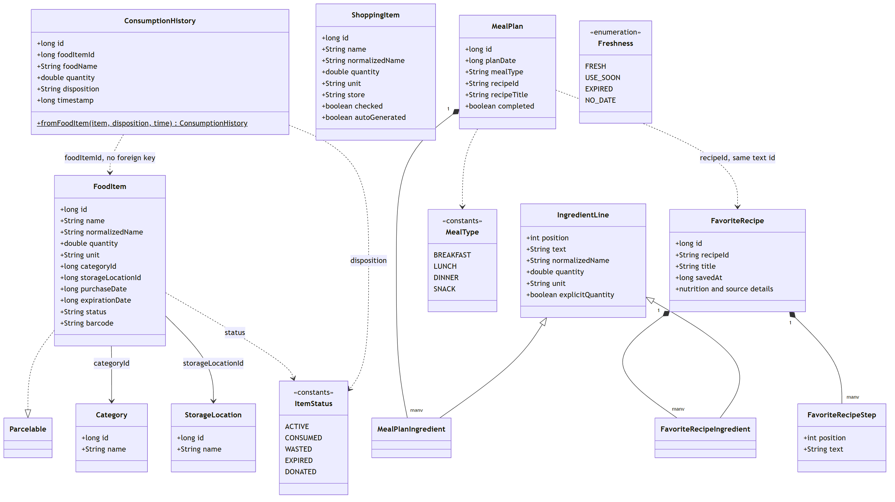

Query results that are not tables: `StockSummary` (total of one normalized ingredient in one unit),
`DispositionCount` and `WasteStats` (waste figures), `MealPlanWithIngredients` and `FavoriteRecipeWithIngredients`
(a parent with its rows, loaded in one query).

### 3.2 Repositories, ViewModels and data sources

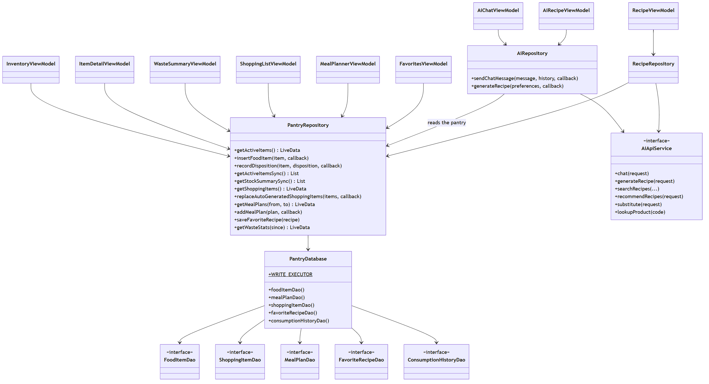

`PantryDatabase` also exposes `CategoryDao` and `StorageLocationDao`. The ViewModels of the recipe screens
(`RecipeDetailViewModel`, `SavedRecipeViewModel`) follow the same pattern as the ones shown.

### 3.3 Expiration reminders and notifications

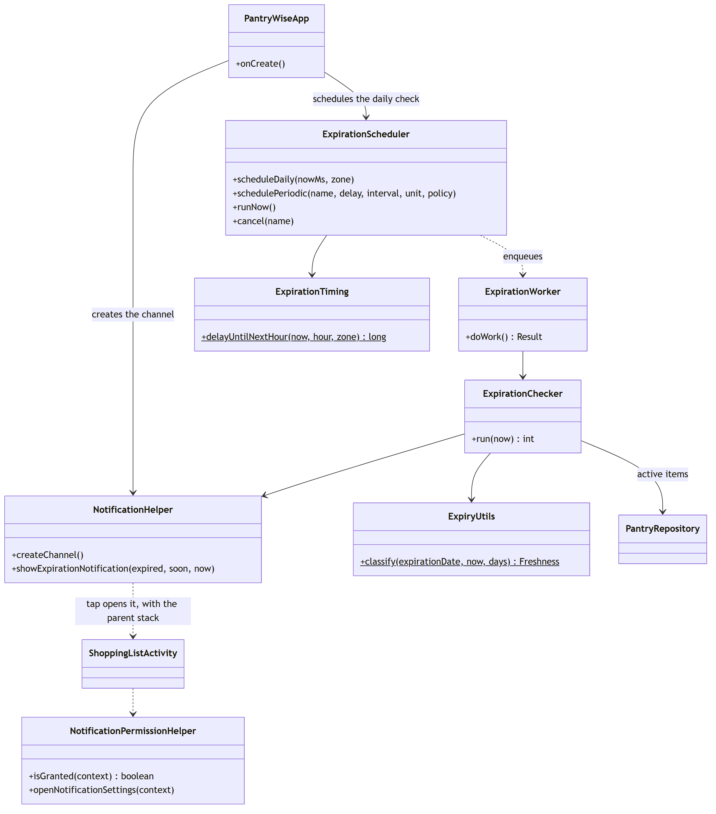

### 3.4 Shopping list and weekly meal planner

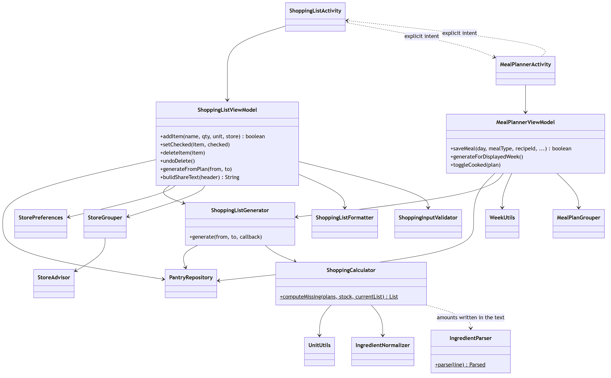

### 3.5 Barcode scanner and add-food form

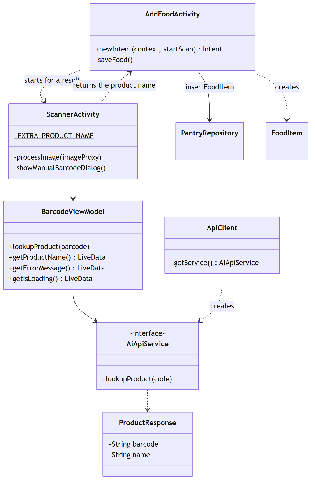

### 3.6 AI screens

The AI assistant, the AI recipe, the recipes and the favourites have about thirty classes. Their diagram is in
[AI engine](04-ai-engine.md#4-class-diagram) so it can be read next to the workflow it implements.

## 4. Data model

### 4.1 Entity-relationship diagram

Room version **4**, ten tables. Foreign keys are declared only where a child row cannot exist without its parent
(ingredients and steps, with `ON DELETE CASCADE`). The other links are plain ids, checked by the code, because a
history row must survive the deletion of the item it describes.

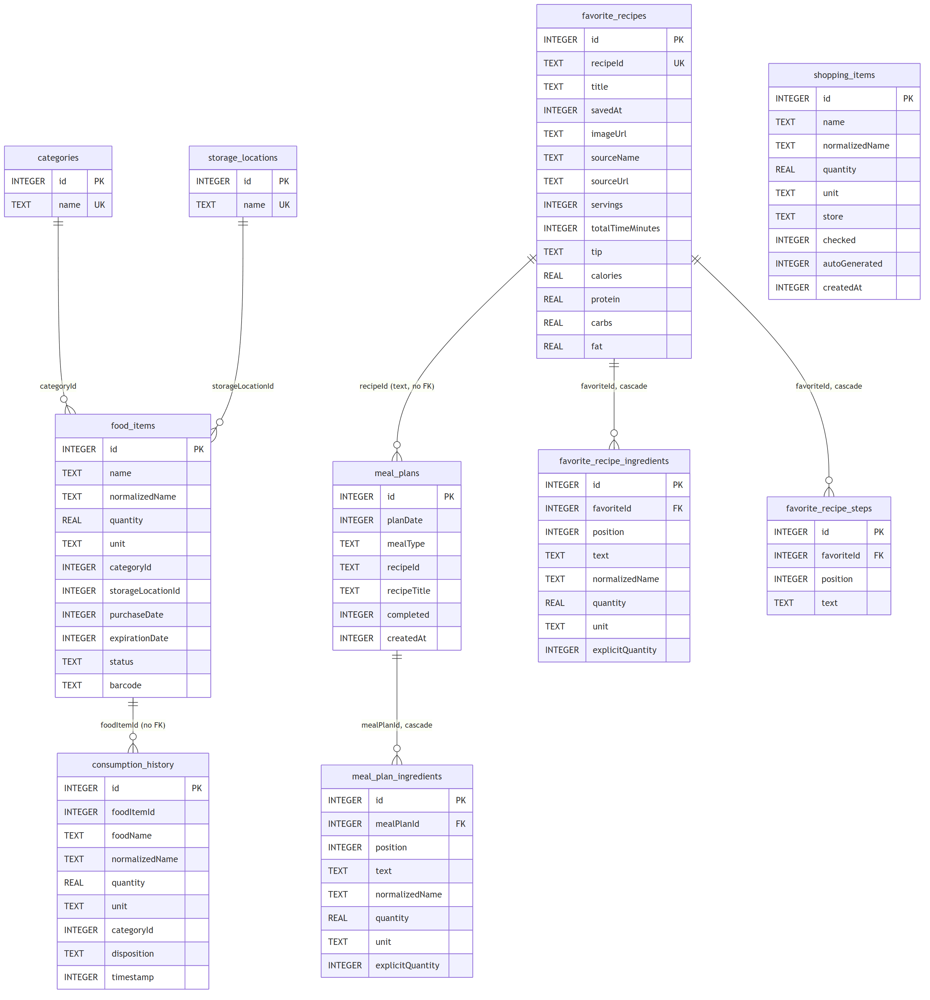

### 4.2 Decisions

| Decision | Reason |
|---|---|
| `status` of a food item is text (`ACTIVE`, `CONSUMED`, `WASTED`, `EXPIRED`, `DONATED`) | Easy to read in the exported schema and in the history |
| Removing food from the pantry is a **status change plus a history row in one transaction** | The waste statistics never disagree with the inventory |
| `consumption_history` repeats the name, quantity and category of the item | The history stays correct if the item is edited or deleted later |
| Indexes on `expirationDate`, `status`, `normalizedName`, `planDate`, `timestamp`, `disposition` | The screens filter and sort by them |
| Names of categories and storage places are **keys** (`DAIRY`, `FRIDGE`), translated in the UI | The data does not depend on the language |
| Default rows are seeded when the file is created (`FRIDGE`, `FREEZER`, `PANTRY`, and eight categories); ids follow the order of the arrays | The code can use constants such as `StorageLocation.FRIDGE_ID` |
| `favorite_recipes.recipeId` is unique and also used by `meal_plans.recipeId` | A planned meal can point to a favourite, or to a custom recipe with its own id |

### 4.3 Migrations

`fallbackToDestructiveMigration()` is deliberately **not** used, so an update never erases the household's data.
Every version has its exported schema in `app/schemas/` and every migration is tested (`MigrationsTest`).

| Migration | Change |
|---|---|
| 1 to 2 | Adds `meal_plans` |
| 2 to 3 | The ingredient text of meals and favourites moves from one column to the tables `meal_plan_ingredients` and `favorite_recipe_ingredients`. Each old line is parsed once into a row. The parent tables are rebuilt without the old column, keeping their ids |
| 3 to 4 | `favorite_recipes` gets optional columns (image, source, servings, time, tip, nutrition) and the new table `favorite_recipe_steps`, so a saved recipe opens offline |

To change the schema: raise `version` in `PantryDatabase`, add a `Migration` to `Migrations.ALL`, and commit the new
JSON in `app/schemas/`.

## 5. Object diagrams

These show the objects that exist at run time after the developer tool **Fill DEMO scenario** (debug builds, button
11 in [Getting started](../03-getting-started.md#37-developer-tools-debug-builds-only)). Mermaid has no object
diagram type, so each object is a box with its class and the values of its fields.

### 5.1 Pantry and meal plan of the demo

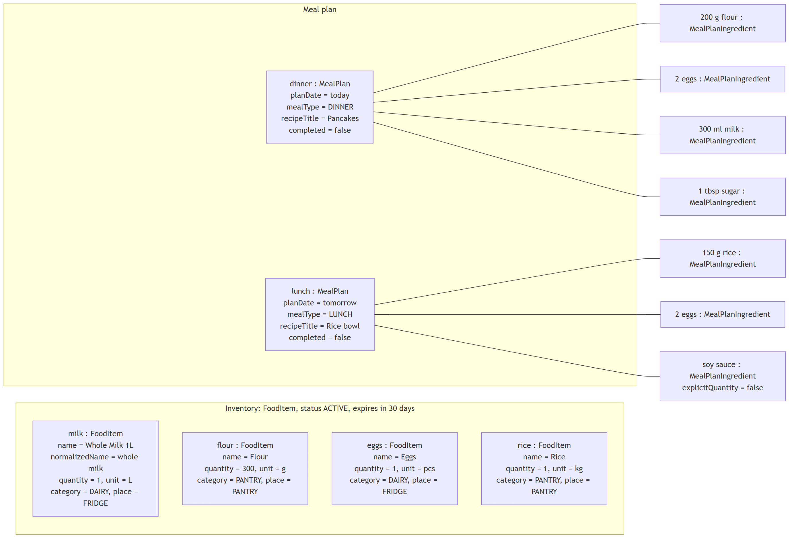

### 5.2 Shopping calculation

`ShoppingCalculator.computeMissing` adds the needs of the two meals, converts units, subtracts the stock, and keeps
what is missing.

| Ingredient | Needed | In stock | Result |
|---|---|---|---|
| flour | 200 g | 300 g | covered |
| milk | 300 ml | 1 L (1000 ml), stored as "whole milk" | covered: every word of "milk" is a word of "whole milk" |
| rice | 150 g | 1 kg (1000 g) | covered |
| eggs | 2 + 2 = 4 | 1 | **3 missing** |
| sugar | 1 tbsp | none | **1 tbsp missing** |
| soy sauce | no amount written | none | **missing, quantity 1 ("presence")** |

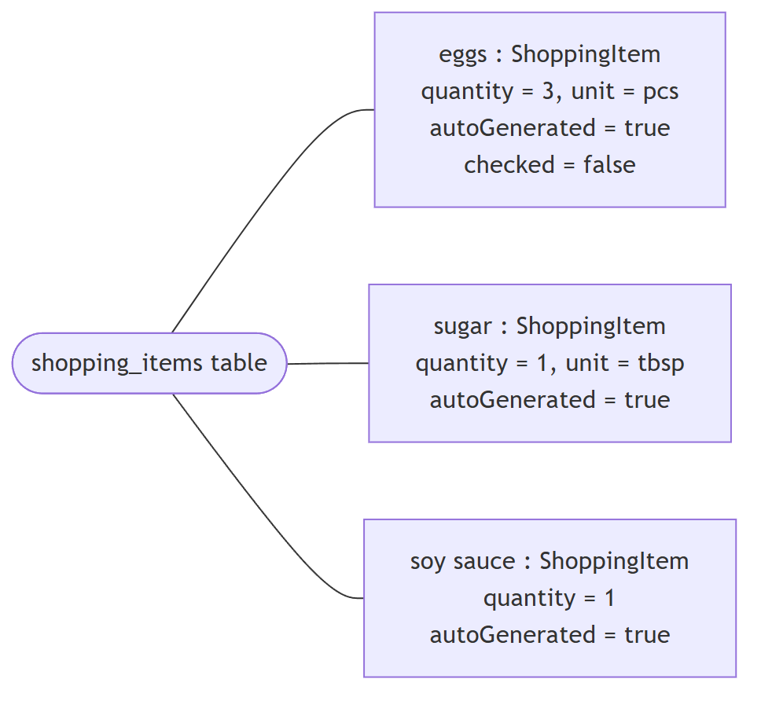

A second generation **replaces** the automatic items and keeps the ones the user typed by hand (`autoGenerated =
false`), which is why the calculator also skips ingredients already on the list as manual items.

### 5.3 A chat request

What `AiRepository.sendChatMessage` sends to the backend when the demo pantry exists and the user asked
"What can I cook with the milk?" (the history is empty and no preferences are sent yet).

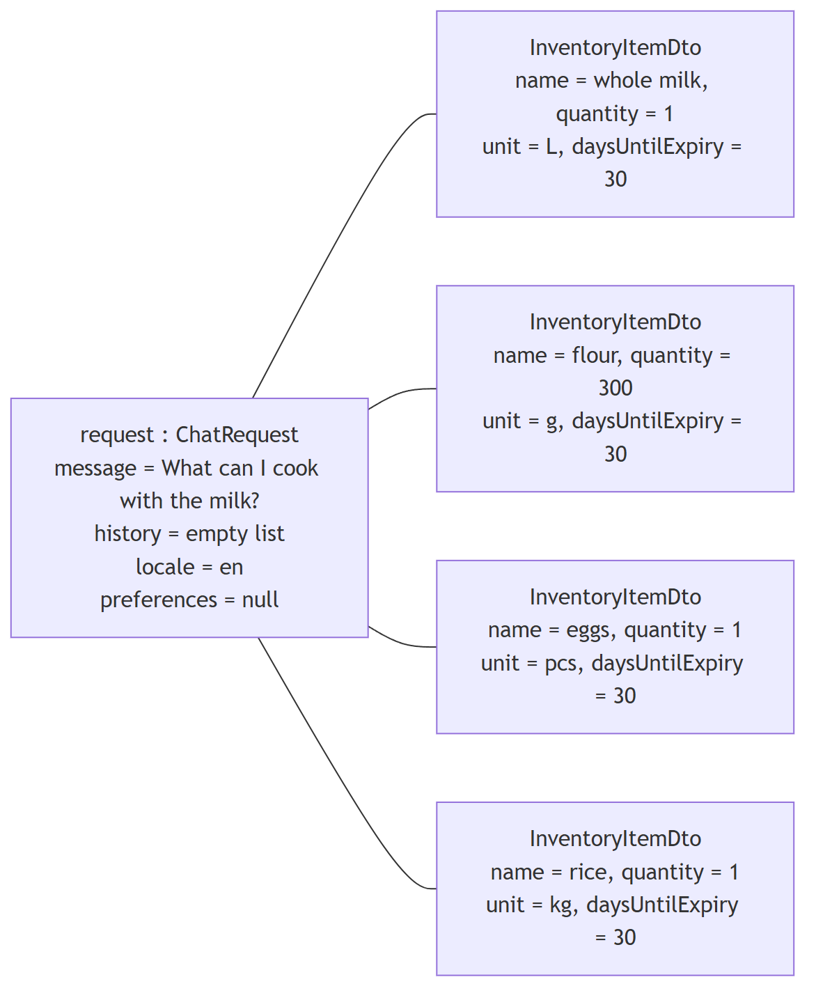

`InventoryMapper` sorts the items by urgency (soonest first, unknown last), keeps at most 200 and clamps names and
units to the limits that the backend validates.

## 6. Sequence diagrams

The expiration alert has its own sequence diagram in [Architecture](03-architecture.md#6-background-work).

### 6.1 Scan a barcode and save the food

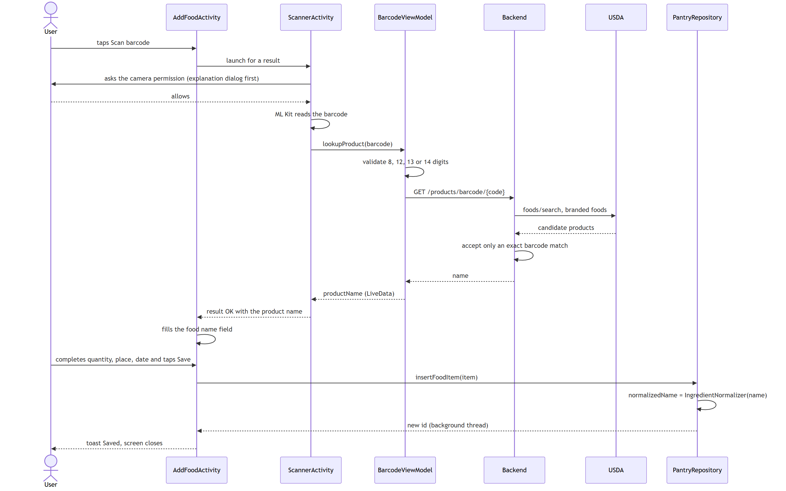

If the code is invalid, the backend answers 404 or the network fails, the view model publishes a string resource id
and the scanner shows the message and lets the user retry or type the barcode.

### 6.2 Generate the shopping list from the meal plan

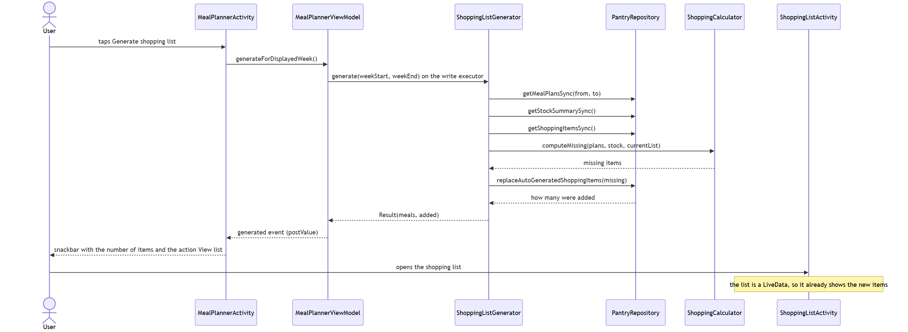

The same generator is used from the shopping list screen (*Generate for the next days*). With no pending meal in
the period the result says so (`meals == 0`), which is different from having everything in stock.

### 6.3 Record what happened to a food item

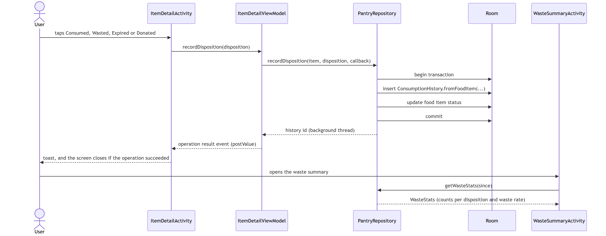

An item whose status is no longer `ACTIVE` disappears from the pantry list, from the stock used by the shopping
calculation, and from the expiration alerts, all through the same filter in `FoodSql`.
