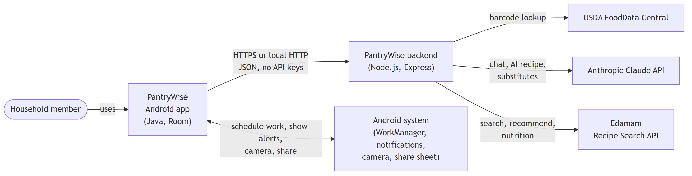
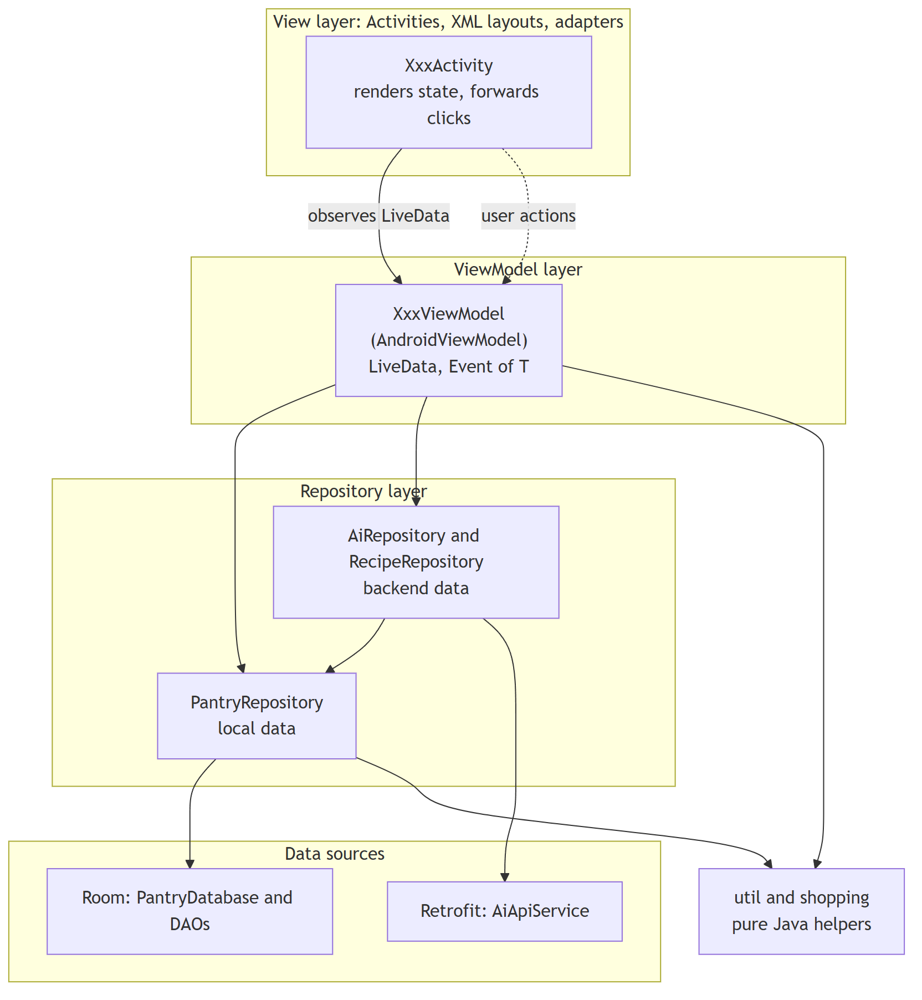
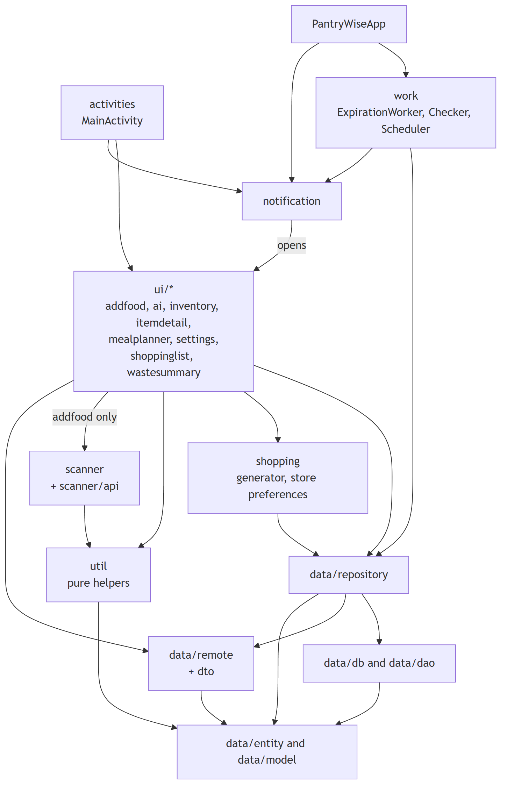
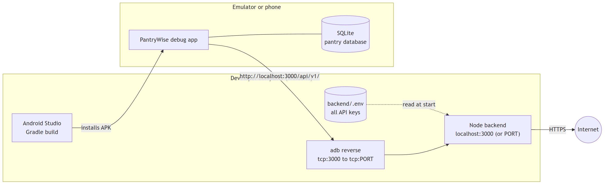
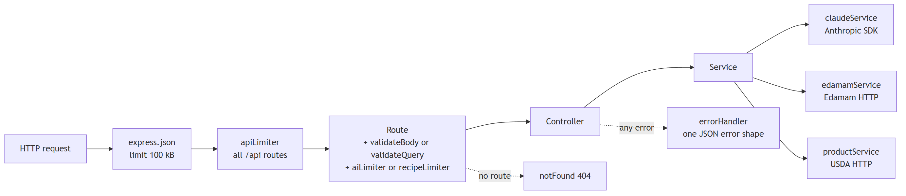
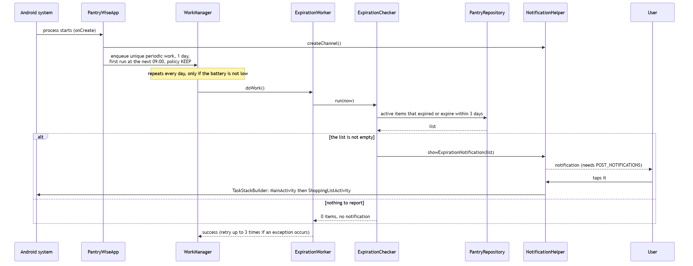
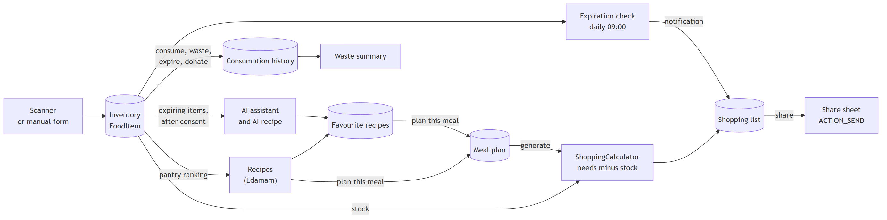

# Architecture

This document describes how PantryWise is built from the outside in: the system and its neighbours, the layers of
the Android app, the packages and their dependencies, how it is deployed and run, the backend, the background work,
and the data flow that connects the features. The classes themselves are listed in [Design](02-design.md) and the
AI engine has its own document, [AI engine](04-ai-engine.md).

All diagrams are PNG images made from [Mermaid](https://mermaid.js.org/) sources (see [diagrams](../diagrams/README.md)).

## 1. System context

PantryWise has three parts: the **Android app**, a small **backend** that keeps every API key off the
device, and three **external services**. Everything the user owns (pantry, shopping list, plans, history,
favourites) stays in a database on the phone.

| Element | Responsibility | Holds a secret? |
|---|---|---|
| Android app | All screens, the local database, the expiration check, the shopping and planning logic | No |
| Backend | Validates requests, limits their rate, calls Claude, Edamam and USDA, normalizes the answers, checks AI recipes for allergens | Anthropic, Edamam and USDA keys, in `backend/.env` |
| Anthropic Claude | Writes chat answers, recipes from expiring food and ingredient substitutes | - |
| Edamam | Recipe search, ranked recommendations and nutrition values | - |
| USDA FoodData Central | Gives the product name for a barcode, asked by the backend | - |
| Android system | Runs the daily job, delivers the notification, provides the camera and the share sheet | - |

Without the backend and the keys, the inventory, shopping list, meal planner, waste statistics and expiration
reminders still work. Only the AI assistant, the recipes and the barcode lookup need the network.

## 2. Layers of the app

The app follows **MVVM** with a single data entry point.

| Layer | Rule |
|---|---|
| View | Activities only render state and forward clicks. They never query data. Lists use `RecyclerView` with an adapter and a `ViewHolder` |
| ViewModel | Extends `AndroidViewModel`, creates its repository, exposes `LiveData`. It survives rotation. One-shot messages (toast, snackbar) use the `Event` wrapper so they are not replayed after a rotation |
| Repository | `PantryRepository` is the only access point to the local database. `AiRepository` and `RecipeRepository` are the only access points to the backend |
| Data sources | Room for local data, Retrofit for the backend. Nothing outside the repositories talks to them |
| Helpers | `util` and `shopping` hold pure logic (dates, units, ingredient parsing, shopping maths). They do not use Android views, so the JVM tests can run them directly |

**Threading.** Room reads that return `LiveData` are safe anywhere. Methods whose name ends in `Sync` run on a
background thread. Writes go through `PantryRepository`, which sends them to one single-thread executor
(`PantryDatabase.WRITE_EXECUTOR`) so they keep their order. Their callbacks arrive on that background thread, so
ViewModels use `postValue`, never `setValue`. `AiRepository` uses its own single-thread executor for network calls.

## 3. Packages and dependency rules

The code lives in the package `com.cp470.groupproject`. The diagram shows the dependencies that exist in the code
(measured from the `import` statements, a group of packages is drawn once when they behave the same).

Rules that hold in the code, and the exceptions that are known:

| Rule | Status |
|---|---|
| Views and ViewModels reach data only through a repository | Holds. Two ViewModels (`MealPlannerViewModel`, `ShoppingListViewModel`) import `PantryDatabase` only to reuse its write executor, not to run queries |
| `data/*` never depends on `ui/*` | Holds |
| `util` has no Android view classes | Holds. It uses the entity types for its calculations |
| `scanner` is independent of the database | Holds. `ScannerActivity` returns the barcode text to `AddFoodActivity`, which fills the form |
| No package cycles | **Three small cycles exist.** `ui/mealplanner` and `ui/shoppinglist` open each other with explicit intents. `notification` opens `ShoppingListActivity`, and the shopping list screen calls `NotificationPermissionHelper` (to open the system notification settings). `data/entity` and `data/model` reference each other (an entity and the query-result types used with it) |

The cycles are shallow, they only involve screen navigation and plain data types, and they are listed as technical
debt rather than hidden.

### Navigation

`MainActivity` is the hub. Every other screen declares it (or its logical parent) as `parentActivityName` in the
manifest, so the up arrow works. The notification opens `ShoppingListActivity` through a `TaskStackBuilder`
that adds the parent stack, so *Back* from that screen goes to `MainActivity` and not out of the app. The full
navigation map is in [Features and status](../02-features-status.md#21-screens-and-navigation).

## 4. Deployment and network

| Topic | How it works |
|---|---|
| Debug build | `AI_BASE_URL` is `http://localhost:3000/api/v1/`. On the emulator `localhost` is the emulator itself, so `adb reverse` forwards the port to the computer. Plain `http` to `localhost` and `10.0.2.2` is allowed only by the debug network security configuration. HTTP bodies are logged to Logcat in debug builds only |
| Release build | `AI_BASE_URL` is a placeholder (`https://example.invalid/api/v1/`), cleartext traffic is not allowed and nothing is logged. A real HTTPS address of a hosted backend is a roadmap item |
| Configuration | `backend/.env` holds every API key and is not committed. `backend/.env.example` lists every variable. `local.properties` only holds the Android SDK path and is not committed either |
| Developer tools | `DevToolsActivity` exists only under `app/src/debug`, so it is absent from release builds |
| Run steps | See [Getting started](../03-getting-started.md) |

## 5. Backend

The backend is a small Express 5 application (`backend/src`). Its only jobs are to **keep the keys**, **validate**
what the app sends, and **shape** what Claude and Edamam answer.

| Endpoint | Controller and service | External call |
|---|---|---|
| `GET /api/v1/health` | health route | none |
| `GET /api/v1/products/barcode/:code` | `productController`, `productService` | USDA (the result is accepted only if its barcode matches exactly) |
| `POST /api/v1/ai/chat` | `chatController`, `chatService` | Claude |
| `POST /api/v1/ai/recipe` | `aiRecipeController`, `aiRecipeService` | Claude (checked afterwards for structure and allergens) |
| `GET /api/v1/recipes/search` | `recipeController`, `recipeService` | Edamam |
| `POST /api/v1/recipes/recommend` | `recipeController`, `recommendationService` | Edamam, then ranked against the pantry |
| `POST /api/v1/recipes/substitute` | `recipeController`, `substituteService` | Claude |

| Concern | Implementation |
|---|---|
| Configuration | `config/env.js` reads `.env` with `dotenv` and refuses to start if a required variable is missing. `USDA_API_KEY` is optional: without it only the barcode lookup answers `503` |
| Validation | `middleware/validate.js` holds the limits (message 1000 characters, history 20 turns, inventory 200 items, name 100, unit 20) and answers with a `400` and a code |
| Rate limits | General limit per IP for all `/api` routes (100 per 15 minutes), plus tighter limits for AI routes (10 per minute) and for recipe and barcode routes (20 per minute). All are configurable |
| Errors | `AppError` carries a status and a code. `errorHandler` turns every error into `{"error":{"code","message","details"}}`. Unknown errors become a generic `500` without internals |
| Prompts | `utils/prompts.js` holds the system prompts, so the model's scope and safety rules are in one place |
| Timeouts | Configurable per provider (Claude 20 s, Edamam 10 s, USDA 10 s by default) |

The app mirrors the same shape: `ApiClient` builds one Retrofit and OkHttp instance with connect, read and write
timeouts, `ApiCalls` runs a call and turns every outcome (success, HTTP error, network failure) into an `ApiResult`
with an `AiError`, and the `*ErrorText` helpers turn that into a localized message. The endpoints, bodies and
error codes are documented in [AI engine](04-ai-engine.md#5-backend-contract).

## 6. Background work

Expiration reminders run even if the app is closed. Android decides when to run the job, so the app only has to
describe it.

| Topic | Detail |
|---|---|
| Schedule | `ExpirationScheduler.scheduleDaily` computes the delay until the next 09:00 (local time zone) with `ExpirationTiming`, and enqueues a unique periodic request named `expiration_check_daily` with the policy `KEEP`, so restarting the app never duplicates it |
| Constraints | Battery not low |
| Selection | Active items (not consumed, wasted or donated) that are expired or expire in 3 days or fewer (`ExpiryUtils.DEFAULT_USE_SOON_DAYS`). One notification summarizes them |
| Permission | From Android 13 the notification needs the runtime permission. `NotificationPermissionHelper` asks when the main screen opens, shows an explanation dialog first when Android recommends it, and offers a *Settings* snackbar after a refusal. If it is denied the check does nothing visible and does not crash |
| Destination | The notification opens `ShoppingListActivity` with the parent stack (`TaskStackBuilder`) |
| Errors | The worker retries up to three times and then reports failure and logs it |
| Testing | `ExpirationScheduler` takes the `WorkManager` as a constructor argument and `ExpirationChecker` takes the repository and the notifier, so both are tested with Mockito. In debug builds the developer tools can run the check at once or schedule it for a minute later |

## 7. Data flow: from expiring food to shopping list

The features are connected. This is the thread of the product, and it shows how the pieces of the architecture
work together.

The important step is the shopping calculation. `ShoppingListGenerator` reads the planned meals, the stock and the
current list. `ShoppingCalculator` then, for each ingredient, compares by **normalized name**
(`IngredientNormalizer`), converts units to a base unit (`UnitUtils`), subtracts what the pantry has (expired food does not count), skips ingredients
that are already on the list as manual items, and saves only the missing quantity. Quantities written in the ingredient text are parsed by
`IngredientParser`. When no quantity can be read, the ingredient counts as *present or missing* instead of a
number.

## 8. Security and privacy

| Topic | What the project does | What to know |
|---|---|---|
| API keys | The Anthropic, Edamam and USDA keys live only in `backend/.env`, which is not committed. The app contains no key | The scanner sends the barcode to the backend, which asks USDA. A barcode is not personal data |
| What leaves the device | Chat messages (up to 20 turns of history), and with them a list of pantry items with **name, quantity, unit and days until expiry** only. Nothing else (no prices, no notes, no identifiers) is sent | The user sees a **consent dialog** before the first message is sent (once per chat screen). Cancelling sends nothing and keeps the typed text |
| Transport | Release builds accept only HTTPS. Debug builds may use `http` to `localhost` | Keys are never sent by the app, they stay between the backend and the providers |
| Logging | HTTP bodies are logged only when `BuildConfig.DEBUG`. The code must not log user data | The rule is part of the project conventions |
| Abuse and cost | Request size limit, validation, per-IP rate limits and timeouts protect the keys' quota | The limit is per IP address, so one device behind a shared network can block others (roadmap item 13) |
| AI safety | The system prompts keep the assistant within cooking, food storage and nutrition basics. AI recipes are checked by the backend for structure and for allergens given in the preferences | The allergen checks use the food profile that the app sends, so they only work when the user has listed allergies; the first-launch screen asks for an answer. The assistant is not medical advice |
| Local data | The database is private to the app. The notification contains only item counts and names | `allowBackup` is `true` in the manifest, so the system may back the database up to the user's own account. Decide on this before a public release |
| Permissions | `INTERNET`, `CAMERA`, `POST_NOTIFICATIONS`. Camera and notifications are requested at runtime with an explanation | The app does not crash if either is denied: manual barcode entry and the in-app list remain |
| Debug tools | `DevToolsActivity` and the sample data are in the `debug` source set | They cannot ship in a release build |

## 9. Architectural decisions

| Decision | Reason | Cost |
|---|---|---|
| MVVM with `AndroidViewModel` and one repository per source | Taught in the course, survives rotation, easy to test with a fake repository | Every screen has several small classes |
| One backend in front of Claude, Edamam and USDA | Keeps the keys off the phone, lets the server validate, limit and shape responses | Someone must run it, and the release build still needs a hosted address |
| Room with explicit migrations | Reliable local storage and offline use | Entity changes need a version bump and a migration |
| WorkManager for reminders | Survives app closing and reboot, respects battery rules | Exact time is not guaranteed, the daily check can run later than 09:00 |
| Pure helpers in `util` and `shopping` | Logic is tested on the JVM in milliseconds | More small classes |
| Feature string files and a separate `debug` source set | Fewer merge conflicts between five branches, no developer tools in release | More files to keep in sync (English and Spanish) |
