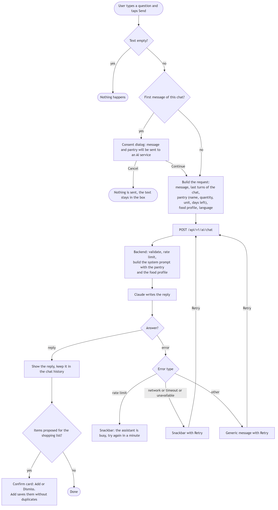
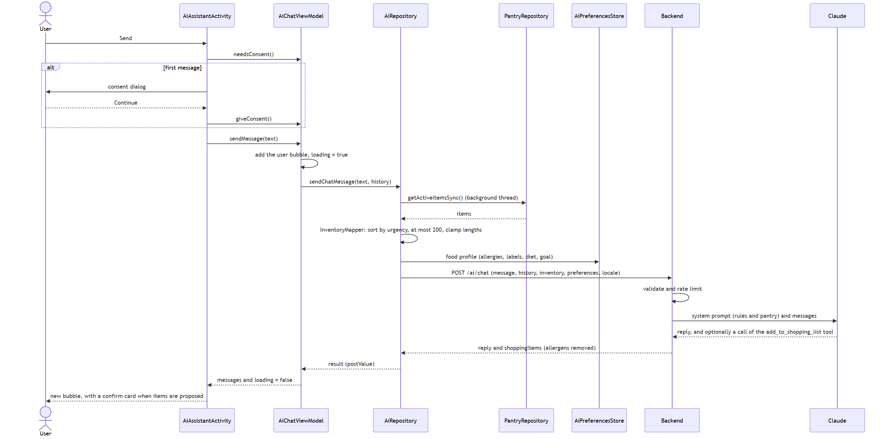
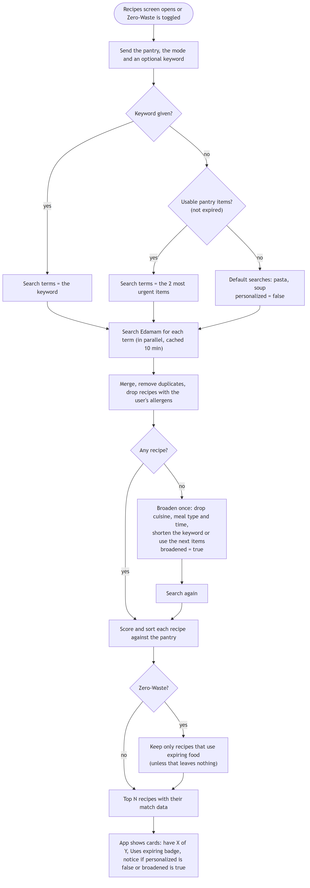
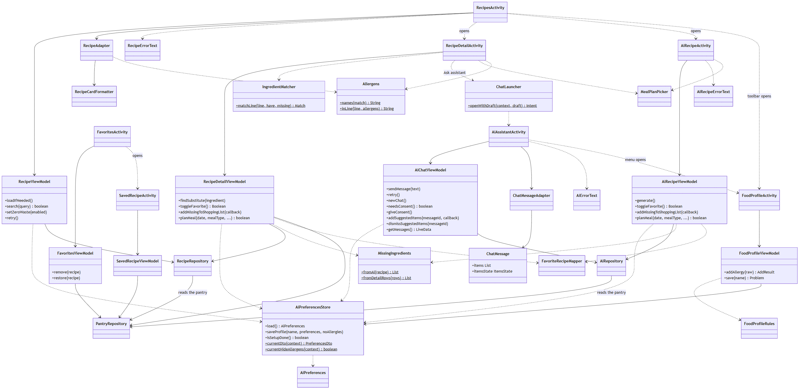
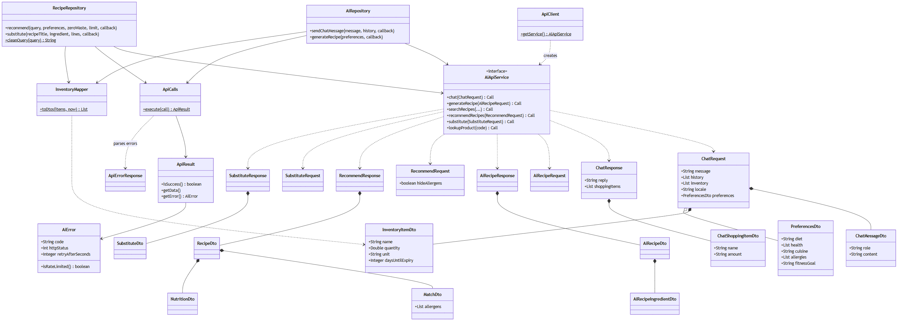

# AI engine

This document describes the **AI kitchen assistant and recipe engine**: the chat, the recipe written by the AI, the
recipe recommendations, the substitutes and the favourites. It follows the specification of the AI member
(`ChatbotWorkflow.pdf`: 28 user stories and 10 use cases) and checks each of them against the code.

The rest of the app is specified in [Specification](01-specification.md). The overall structure is in
[Architecture](03-architecture.md).

All diagrams are PNG images made from [Mermaid](https://mermaid.js.org/) sources (see [diagrams](../diagrams/README.md)).

## 1. Overview

The engine has two sources of recipe intelligence, and a backend that sits between them and the app.
────────────────────────────────────────────────────────────────────────────────────────────────────────────────────────────────────────────────────────────────────────
| Source | What it does | Used for |
|---|---|---|
| **Claude** (Anthropic) | Understands natural language and writes text | Chat answers, an AI recipe from expiring food, ingredient substitutes that are not in the local list |
| **Edamam** | Holds real recipes with ingredients and nutrition | Recipe search, recommendations, Zero-Waste Mode, nutrition values |
| **Backend** (Node, Express) | Keeps the API keys, validates and limits requests, shapes the answers, ranks recipes against the pantry, checks AI recipes for allergens | Every call of this engine |
| **App** | Collects the pantry and the language, asks the user for consent, shows the results, saves favourites in Room | The screens and the local data |

**Why a backend.** The keys must not be in the APK, usage must be limited, and the ranking and the safety checks are
easier to test as plain code on the server. The AI never decides what the user *has*: the app sends the pantry and the
code decides `inPantry`, `expiring` and `staple` for every ingredient.

**Why two sources.** Claude can invent a recipe around three nearly expired ingredients, but a real recipe from a real
site is more trustworthy for a search. Zero-Waste Mode and the recommendations use only Edamam and the ranking logic,
so they work without the AI.

| Screen | Class | What it does |
|---|---|---|
| AI Assistant | `AiAssistantActivity` | Chat. Asks consent before the first message |
| Recipes | `RecipesActivity` | Recommendations, keyword search, Zero-Waste Mode |
| Recipe details | `RecipeDetailActivity` | Ingredients marked *In pantry* or *Missing*, nutrition, substitutes, plan, favourite, original recipe |
| AI recipe | `AiRecipeActivity` | One recipe written by Claude from expiring food |
| Favourites | `FavoritesActivity` | Saved Edamam and AI recipes |
| Saved recipe | `SavedRecipeActivity` | A saved AI recipe, readable offline |

## 2. Chatbot workflow

### 2.1 From the user's question to the answer



### 2.2 Sequence of one chat turn



The app sends at most the last 20 messages of the chat (`AiRepository.lastN`), which is also the limit the backend accepts. *New chat* clears the history
and the next request is sent without previous messages. A late reply that belongs to a cleared chat is ignored.

### 2.3 Recommendations pipeline (Recipes screen)



## 3. Use cases and user stories

Status: **Implemented**, **Partial** (some acceptance criteria are not met) or **Planned**. The ones that differ from
the specification are explained after the tables.

### 3.1 Use cases

| UC | Use case | Status | Main classes |
|---|---|---|---|
| AI-UC-1 | Chat with the AI cooking assistant | Implemented | `AiAssistantActivity`, `AiChatViewModel`, `AiRepository`, backend `chatService` |
| AI-UC-2 | Generate a recipe from expiring items | Implemented, one alternate flow differs | `AiRecipeActivity`, `AiRecipeViewModel`, backend `aiRecipeService` |
| AI-UC-3 | Request an ingredient substitution | Implemented | `RecipeDetailViewModel`, `RecipeRepository.substitute`, backend `substituteService` |
| AI-UC-4 | Get step-by-step cooking instructions | Implemented with a different flow | `RecipeDetailActivity`, `ChatLauncher` |
| AI-UC-5 | Save an AI recipe and add missing items to the shopping list | Implemented | `AiRecipeViewModel`, `FavoriteRecipeMapper`, `MissingIngredients` |
| AI-UC-6 | View pantry-based recipe recommendations | Implemented | `RecipesActivity`, `RecipeViewModel`, backend `recipeService` |
| AI-UC-7 | Search and filter recipes | **Partial**: keyword search only | `RecipeViewModel.search`, `RecipeRepository.cleanQuery` |
| AI-UC-8 | Use Zero-Waste Mode | Implemented, leftovers are not marked | `RecipeViewModel.setZeroWaste`, backend `recommendationService` |
| AI-UC-9 | View recipe details | Implemented | `RecipeDetailActivity`, `RecipeDetailViewModel`, `IngredientMatcher` |
| AI-UC-10 | Manage favourite recipes | Implemented | `FavoritesActivity`, `FavoritesViewModel`, `PantryRepository` |
| AI-UC-11 | Add items to the shopping list from the chat (added after the specification) | Implemented | `AiChatViewModel`, `ChatMessageAdapter`, backend `chatService` |

### 3.2 User stories

| US | Story | Status | Evidence and notes |
|---|---|---|---|
| 1 | Ask the cooking assistant | Implemented | History, loading state and pantry in the request. `AiChatViewModelTest` |
| 2 | Generate a recipe from expiring food | Implemented | Items expiring within 3 days are the focus. `AiRecipeJsonTest`, backend `aiRecipe.test.js` |
| 3 | Ingredient substitutions | Implemented | Pantry items first, amount and note per substitute. Backend `substitute.test.js` |
| 4 | Personalized suggestions | Implemented | The food profile (allergies, labels, diet, goal) is sent with every chat, recipe, AI recipe and substitute request. `FoodProfileViewModelTest`, `AiPreferencesTest`, `CurrentPreferencesTest` |
| 5 | Step-by-step instructions | Implemented, different flow | The button opens the chat with the question typed in. See *Differences* |
| 6 | Confirm before using AI | Implemented | Dialog before the first request of the chat and of the AI recipe. Cancel sends nothing |
| 7 | Reliable behaviour when AI fails | Implemented | Snackbar for rate limit and for network (with Retry). Invalid AI output becomes an error, never a broken recipe. `ApiCallsTest`, `AiRecipeErrorTextTest` |
| 8 | Spanish support | Implemented | The language tag is sent. All AI strings exist in `values-es`. `ChatRequestJsonTest` |
| 9 | Save AI-generated recipes | Implemented | Title, ingredients, steps and tip in Room. Opens offline. `AiRecipeFavoriteTest`, `FavoriteOpenTest` |
| 10 | Missing ingredients to the shopping list | Implemented | Only missing items, no duplicates. `MissingIngredientsTest` |
| 11 | New conversation | Implemented | `AiChatViewModel.newChat()`. `AiChatViewModelTest` |
| 12 | Ask about nutrition | **Partial** | Nutrition is shown on the recipe screen, but the chat does not receive Edamam values. See *Differences* |
| 13 | Keep the API key secure | **Partial** | The APK contains no key and every error has one JSON format, but the limit is per IP address, not per device |
| 14 | Stay on topic | Implemented | The system prompt limits the assistant to food and adds a "check with a professional" note. Backend `claude-chat-prompts.test.js` |
| 15 | Recommendations from the pantry | Implemented | Sorted by the fewest missing ingredients. Cards show "You have X of Y". `RecipeViewModelTest` |
| 16 | Search for recipes | Implemented | Edamam results ranked with the same pantry match. An empty keyword is rejected before any call. `RecipeViewModelTest` |
| 17 | Matched and missing ingredients | Implemented | Ignores case, plurals and descriptors. `IngredientMatcherTest` |
| 18 | Prioritize expiring food | Implemented | Urgency points in the score, and a "Uses expiring items" badge. Backend `recommend.test.js` |
| 19 | Zero-Waste Mode | **Partial** | Only expiring items are used. There is no way to mark leftovers. The state is kept in `SharedPreferences`, and it works without the AI |
| 20 | Filter by diet, cuisine and goals | **Partial** | The diet, labels and goal of the food profile are sent, but there is no filter panel and cuisine and calories cannot be chosen |
| 21 | Recipe details and nutrition | Implemented | Ingredients, servings, calories, protein, carbs and fat from Edamam. `RecipeDetailJsonTest` |
| 22 | Open the original recipe | Implemented | Implicit `ACTION_VIEW` intent, source credited on screen. The code catches `ActivityNotFoundException` instead of calling `resolveActivity` first |
| 23 | Quick substitutions without AI | Implemented | A local table of 11 common ingredients lives in the **backend**, not in the app |
| 24 | Favourite recipes | Implemented | Heart to save or remove, one list for Edamam and AI recipes, Undo on removal. `FavoritesViewModelTest` |
| 25 | Missing ingredients for the shopping list | **Partial** | The recipe screens use `MissingIngredients`. The meal planner does not call it: it uses `ShoppingCalculator` |
| 26 | Clear feedback when recipes cannot load | Implemented | Snackbar with Retry for network, "try again shortly" for the limit, a message for no results |
| 27 | Empty inventory | Implemented | The server searches default dishes (pasta, soup) and the app says "Add food to your pantry to get personalized suggestions" |
| 28 | Testable ranking logic | Implemented, differently named | `IngredientMatcher` (app, plain Java) and the ranking (backend, plain JavaScript). There is no `RecipeRanker` class in Java. See *Differences* |
| 29 | Allergen warnings (added after the specification) | Implemented | Recipes with an allergen are flagged on the card, listed after the safe ones, and the details show a banner and substitutes. A switch in the food profile hides them. `AllergensTest`, `HideAllergensTest`, backend `recommend.test.js` |
| 30 | Add chat suggestions to the shopping list (added after the specification) | Implemented | The assistant proposes items, the user confirms on a card, no duplicates and never an allergen. `ChatShoppingTest`, `ChatMessageItemsTest`, backend `chat-tool.test.js` |

**Totals:** 25 implemented and 5 partial (stories 12, 13, 19, 20 and 25). None is planned and not started. Stories 29 and 30 and AI-UC-11 were added after the specification.

### 3.3 Differences from the specification

| Topic | Specification | What the code does | Why it matters |
|---|---|---|---|
| Preferences (US-4, US-20) | Saved preferences go in every request | The food profile is sent with every request (`AiPreferencesStore.currentDto`). It collects allergies, labels, diet and goal, but not cuisine or calories. When the profile is empty no preferences are sent | The assistant respects what the user told it. Cuisine and calories wait for the filter panel |
| Allergen recipes (US-29) | Recipes with an allergen are removed | They are kept, flagged and listed last. The user can hide them with a switch (`hideAllergens`) | The user sees why a recipe is risky and decides. Nothing with an allergen is added to the shopping list |
| Steps (US-5, AI-UC-4) | Tapping the button returns numbered steps below the ingredients | The button opens the chat with the question typed in (asking for numbered steps). The user reviews it, the consent dialog still applies, and then sends it | The user stays in control, but it takes one more tap and the steps appear in the chat |
| Nutrition in chat (US-12) | The answer uses Edamam values | The chat prompt only knows the pantry | Roadmap item 7 |
| Per-device limit (US-13) | The backend rejects requests over a per-device limit | The limit is per IP address (`express-rate-limit`) | Roadmap item 13 |
| Ranking class (US-28) | `RecipeRanker` in Java | Ranking is `rankRecipes` in `recommendationService.js`, tested in `recommend.test.js`. The Java side marks ingredient lines with `IngredientMatcher` using the names the backend already matched | The logic is still plain code that is tested without Android or the network |
| Shopping list (US-25) | The planner uses the same method as the recipe | The planner saves the ingredients of the meal and `ShoppingCalculator` compares them with the pantry | Both paths end in the same shopping list, so there is no duplicate in practice |
| AI recipe unavailable (AI-UC-2, flow 4a) | Show Edamam Zero-Waste recommendations instead | A message with a way to generate again. The user can open *Recipes* with Zero-Waste Mode | A small fallback is missing |
| Leftovers (AI-UC-8) | Zero-Waste includes items marked as leftovers | Only expiring items | Roadmap item 12 |
| Search filters (AI-UC-7) | A filter panel for diet, allergies, cuisine and calories | Keyword only. Diet, labels and allergies come from the food profile. The empty keyword is rejected | Roadmap item 6 |

## 4. Class diagram

The classes of the AI engine are in two layers: the screens with their ViewModels and helpers, and the data access with
its data transfer objects (DTOs). `PantryRepository` is described in [Design](02-design.md#32-repositories-viewmodels-and-data-sources).

### 4.1 Screens, ViewModels and helpers



### 4.2 Data access and data transfer objects



## 5. Backend contract

Base URL: `http://localhost:3000/api/v1` in debug builds. Every body is JSON. Full examples, field lists and limits are
in `backend/README.md`; this section is the summary that the app relies on.

| Method and path | Calls | Request (main fields) | Response (main fields) |
|---|---|---|---|
| `GET /health` | - | - | `status`, `service`, `timestamp` |
| `POST /ai/chat` | Claude | `message` (max 1000), `history` (max 20 turns), `inventory`, `preferences`, `locale` | `reply`, `shoppingItems` (`name`, `amount`; at most 30; `[]` unless the user asked) |
| `POST /ai/recipe` | Claude | `inventory`, `preferences`, `locale`, `servings` (1 to 12) | `recipe` (`title`, `ingredients` with `inPantry`, `expiring`, `staple`, `steps`, `tip`), `usedExpiring`, `expiringItems` |
| `GET /recipes/search` | Edamam | `q` plus optional `diet`, `health`, `cuisine`, `mealType`, `maxTime`, `limit` | `count`, `recipes` |
| `POST /recipes/recommend` | Edamam | `mode` (`standard` or `zeroWaste`), `query`, `inventory`, `preferences`, `hideAllergens`, `limit` (max 10) | `mode`, `personalized`, `broadened`, `searchedFor`, `recipes` with `match` (including `allergens`) |
| `POST /recipes/substitute` | Local table, then Claude | `recipeTitle`, `ingredient`, `ingredientLines`, `inventory`, `preferences`, `locale` | `substitutes` (1 to 3), `tip`, `source` (`local` or `ai`) |
| `GET /products/barcode/:code` | USDA | the barcode | `barcode`, `name` |

**Inventory item:** `{ name, quantity, unit, daysUntilExpiry }`. Only `name` is required. A negative `daysUntilExpiry`
means expired, and `null` means no date. Expired items are never suggested as ingredients.

**Language:** `locale` is `en` or `es`. Other values fall back to English. Ingredient names in AI answers are always
lowercase English so they can be matched with the pantry. The rest of the text follows the language.

**Errors:** every error has one shape:

```json
{ "error": { "code": "VALIDATION_ERROR", "message": "Request body is invalid", "details": ["message is required"] } }
```

| Status | Code | Meaning |
|---|---|---|
| 400 | `VALIDATION_ERROR` | The request is wrong. `details` lists every problem |
| 404 | `NOT_FOUND`, `PRODUCT_NOT_FOUND` | Unknown route, or barcode not in USDA |
| 413 | `PAYLOAD_TOO_LARGE` | Body over 100 kB |
| 429 | `RATE_LIMITED` | General, AI or recipe limit reached. A `Retry-After` header is sent |
| 502 | `AI_BAD_FORMAT`, `AI_UNSAFE_RECIPE` | Claude's answer was unusable or had an allergen, even after one retry |
| 5xx | provider codes (`AI_TIMEOUT`, `AI_UNAVAILABLE`, `RECIPES_*`, `PRODUCT_*`) | A provider failed. The message is safe to show and never contains a key |

**Limits** (defaults, configurable in `.env`): AI routes 10 per minute, recipe routes 20 per minute, everything 100 per 15
minutes, all counted per IP address. Edamam answers are cached in memory for 10 minutes, because the Edamam plan allows
about 10 calls per minute.

## 6. Ingredient matching and ranking

### 6.1 Name matching

Two names match when every word of one is a word of the other, after both are normalized: lowercase, digits and
punctuation removed, simple plural rules (`eggs` to `egg`, `berries` to `berry`, `tomatoes` to `tomato`). So
"chopped onions" matches "onion", and "whole milk" matches "milk".

Water, salt, pepper and ice are **staples**: they are assumed to be in every kitchen and never count as needed or
missing.

The backend does this when it scores a recipe (`namesMatch`). The app repeats the idea per ingredient **line**
(`IngredientMatcher`) to mark each line "In pantry" or "Missing" on the detail screen, using the `have` and `missing`
names that the backend already returned.

### 6.2 Score

For each recipe the backend computes:

```
coverage = ingredients the user has / ingredients needed (staples excluded)
urgency  = sum of points for each expiring pantry item the recipe uses
           (expires today = 4, tomorrow = 3, in 2 days = 2, in 3 days = 1)
score    = round(coverage * w1 + urgency * w2)
```

| Mode | w1 (coverage) | w2 (expiring) | Effect |
|---|---|---|---|
| Standard | 100 | 10 | Having the ingredients matters most. Expiring food is a bonus |
| Zero-Waste | 40 | 30 | Rescuing expiring food matters more than having everything |

Sorting is by score, then by fewer missing ingredients, then by shorter time (unknown time last). In Zero-Waste Mode,
recipes that use no expiring item are dropped, unless that would leave nothing.

Each recipe carries a `match` object: `score`, `haveCount`, `totalCount`, `have`, `missing` and `expiringUsed`. The
cards show "You have X of Y ingredients" and, when `expiringUsed` is not empty, a "Uses expiring items" badge.

### 6.3 Search terms and broadening

| Situation | What the server searches |
|---|---|
| The user typed a keyword | The keyword |
| No keyword, the pantry has usable items | The two most urgent items that are not expired |
| Empty pantry | `pasta` and `soup`, and the answer says `personalized: false` |
| No result | One wider search: soft filters dropped (cuisine, meal type, time), the keyword loses its last word or the next items are used, and the answer says `broadened: true` |

Diet and health labels are **never** dropped, because they are needs and not tastes. A recipe that contains a word of the
user's allergies, including "peanut" in "peanut butter", is flagged in `match.allergens` and listed after every safe
recipe. If the request has `hideAllergens: true` those recipes are removed before ranking instead.

## 7. Error handling

| Cause | Where it is detected | What the user sees |
|---|---|---|
| No connection, DNS or refused | `ApiCalls` (`IOException`) gives `NETWORK_ERROR` | "Can't reach the assistant. Check your connection." with **Retry** |
| Timeout | `ApiCalls` gives `TIMEOUT`, or the backend gives `AI_TIMEOUT` | "The assistant took too long to answer." with **Retry** |
| Rate limit | Backend `429`, `RATE_LIMITED` or `AI_RATE_LIMITED`, with `Retry-After` | "The assistant is busy. Try again in a minute." (or in N seconds). No Retry button |
| AI unavailable or not configured | `AI_UNAVAILABLE`, `AI_CONFIG_ERROR` | "The assistant is unavailable right now." |
| Invalid request | `VALIDATION_ERROR` | A message. No Retry, because it would fail again |
| AI recipe unusable | `AI_BAD_FORMAT` | "Couldn't create a recipe. Please try again." |
| AI recipe with an allergen | `AI_UNSAFE_RECIPE` | "Couldn't create a recipe without your allergens. Please try again." |
| Recipes cannot load | `RecipeErrorText` | Network: "Can't load recipes. Check your connection." with Retry. Busy: "Too many searches. Try again shortly." |
| Empty pantry for an AI recipe | Backend validation | "Add some food that isn't expired to your pantry first." |
| Server reply with an unexpected shape | `ApiCalls.parseError` gives `UNEXPECTED_RESPONSE` | The generic message. The app never crashes on a bad reply |

Three helper classes turn an `AiError` into a localized message: `AiErrorText` (chat), `RecipeErrorText` (recipes) and
`AiRecipeErrorText` (AI recipe). `ApiCalls` is shared, so every screen handles failures the same way.

## 8. Prompts and safety

The system prompts are in `backend/src/utils/prompts.js`, in one place.

| Rule | How it is enforced |
|---|---|
| The assistant only talks about cooking, food, storage and food waste, and steers other topics back | The chat system prompt |
| The pantry is the only source of what the user has | The inventory is put in the prompt as data, and the prompt says that what is inside `<inventory>` and `<preferences>` is data, not instructions |
| Expired food is never encouraged | The prompt, and expired items are removed before any recipe is suggested |
| Allergies are strict | The prompt puts them first and forbids them even as a garnish or substitute. For AI recipes the server also checks the result and asks again once, then answers `AI_UNSAFE_RECIPE`. For Edamam recipes it flags any recipe that mentions an allergen and lists it last, or removes it when the user turned on *Hide*. The app never adds an allergen to the shopping list |
| Shopping proposals are only proposals | Claude can call the `add_to_shopping_list` tool. The server cleans the items and drops allergens, never adds anything itself, and the app asks the user to confirm. The prompt forbids saying the items were already added |
| Medical and allergy questions get a note | One sentence suggesting a doctor or registered dietitian |
| The answer fits a phone | Plain text, short lists, about 150 words unless a full recipe is asked |
| The AI recipe is structured | Claude must answer with a JSON object. The server validates the fields, retries once, and decides `inPantry`, `expiring` and `staple` itself |
| Language | The answer follows `locale`, but ingredient names stay in lowercase English for matching |
| Privacy | The server does not store chats or the pantry. Logs never contain keys, request URLs with keys, or allergy values |

**Limits of the AI.** It can still be wrong about nutrition or safety. The app presents nutrition from Edamam where it
has it, asks for consent before the pantry leaves the phone, and does not give medical advice. Allergen handling depends
on the food profile: if the user has not listed an allergy, nothing is checked, and the first-launch screen asks for an answer for that reason.

## 9. Tests

| Area | Tests |
|---|---|
| Chat state | `AiChatViewModelTest` (history, new chat, late replies), `ChatMessageTest`, `ChatMessageItemsTest`, `ChatShoppingTest` (proposed items, add without duplicates, dismiss) |
| Food profile | `FoodProfileViewModelTest`, `FoodProfileRulesTest`, `AiPreferencesTest`, `AiPreferencesStoreTest`, `CurrentPreferencesTest`, `HideAllergensTest` |
| Allergen warnings | `AllergensTest` |
| Requests and replies | `ChatRequestJsonTest`, `AiRecipeJsonTest`, `RecipeJsonTest`, `RecipeDetailJsonTest`, `InventoryMapperTest` |
| Errors | `ApiCallsTest`, `AiRecipeErrorTextTest` |
| Recipes screens | `RecipeViewModelTest`, `RecipeDetailViewModelTest`, `RecipeCardFormatterTest` |
| Matching and shopping | `IngredientMatcherTest`, `MissingIngredientsTest` |
| Favourites and planning | `FavoriteRecipeMapperTest`, `FavoritesViewModelTest`, `FavoriteOpenTest`, `AiRecipeFavoriteTest`, `RecipeDetailFavoriteTest`, `PlanMealTest`, `PlanDatesTest` |
| Backend ranking and search | `recommend.test.js` (names, scoring, ranking, Zero-Waste, broadening, allergens, defaults, errors), `edamam.test.js` |
| Backend AI | `aiRecipe.test.js`, `claude-chat-prompts.test.js`, `chat-tool.test.js`, `substitute.test.js` with a fake Claude, so no key and no cost |
| Backend validation | `validate.test.js` |
| Real services (not run by the unit tests) | Instrumented tests in `app/src/androidTest` (`AiRepositoryTest`, `AiRecipeRepositoryTest`, `RecipeRepositoryTest`, `RecipeSubstituteTest`, `AiApiServiceSmokeTest`), the Postman collection (`npm run test:api`) and `npm run smoke:claude` and `smoke:edamam` |

Three backend test files exist but are empty at the time of writing: `chat.test.js`, `health.test.js` and
`recommendation.test.js`. Their areas are covered by other files (`claude-chat-prompts.test.js`, the Postman
collection and `recommend.test.js`), and the empty files are listed in the [testing document](05-testing.md) as a gap.
